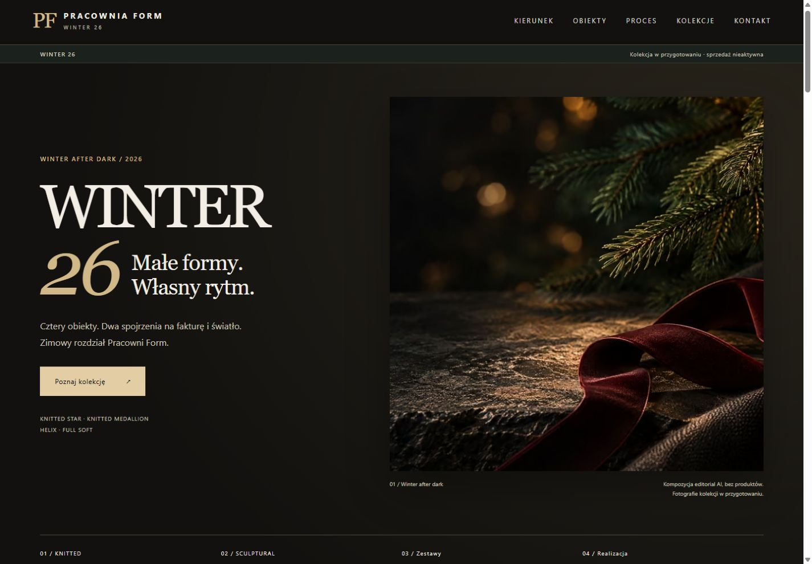
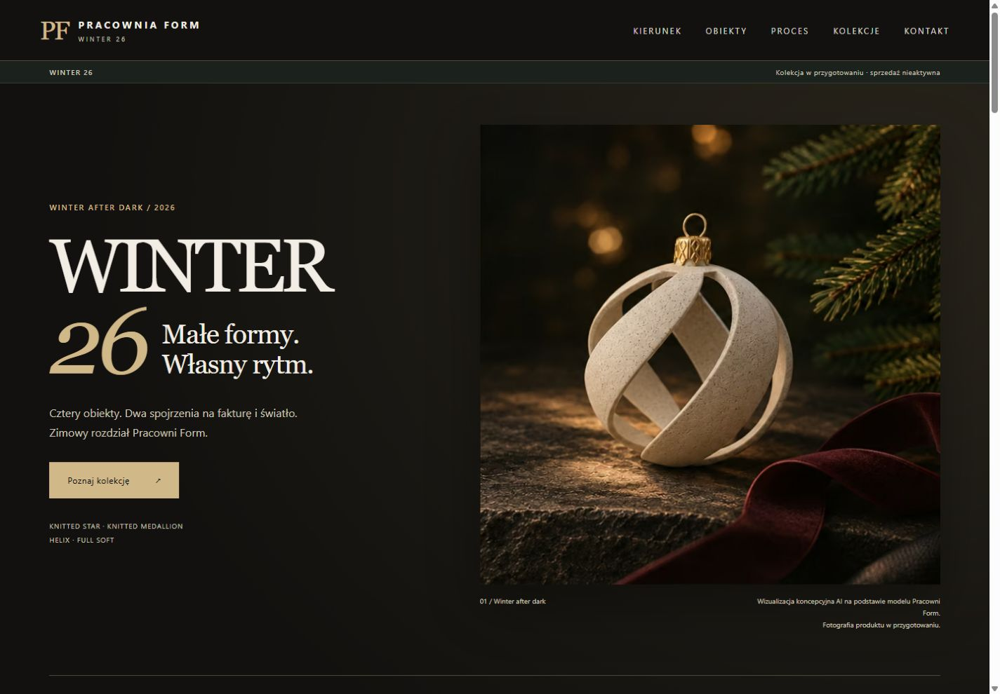
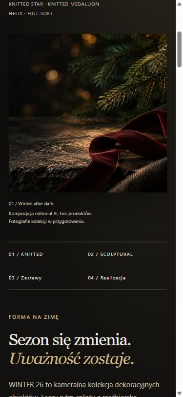
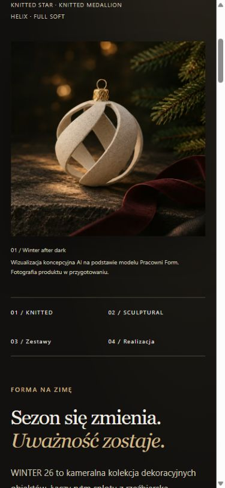

# Hero z otwartą bombką — tymczasowy podgląd

03.11.2026. Wykonanie [korekty priorytetu właściciela](https://github.com/pracowniarachunkowosci-debug/form/pull/11#issuecomment-6616463727). **Wizualizacja jest już podłączona do `winter-26.html`; nie czeka na sesję produktową.** PR pozostaje draftem, bez publikacji.

## Źródło i obróbka

Właściciel dołączył do tej sesji plik `codex-clipboard-9031e908-dbd5-4042-b78c-abb47556e975.png` (1505×1045). Wyodrębniono tylko scenę, prostokąt `(722, 187)–(1415, 880)`, wynik **693×693 px**. Nie osadzono pełnego screenshotu w hero, nie generowano nowej bombki, nie zmieniono geometrii, faktury ani zawieszki. Bez powiększania, wyostrzania AI i dopowiadania detali. [Wycięty kadr źródłowy](sources/open-bauble-concept.png), [metryka i SHA-256](hero-concept-optimization.json), skrypt `scripts/prepare_concept_hero.py`.

Ta rozdzielczość wystarcza do tymczasowego podglądu przy desktopowej szerokości obrazu około 663 px. Nie zapewnia pełnej ostrości przy powiększeniu ani desktopowym DPR 2. Przyszłe zdjęcia zastąpią wizualizację w osobnym etapie; nie blokują bieżącej zmiany.

Podpis: **„Wizualizacja koncepcyjna AI na podstawie modelu Pracowni Form. Fotografia produktu w przygotowaniu.”** Alt również identyfikuje AI. Obraz nie jest przedstawiany jako fotografia produktu. Dotychczasowy OG/social pozostaje editorialem bez produktu; tymczasowej wizualizacji nie przenoszono do metadanych udostępniania.

| Wymiary | AVIF | WebP |
|---|---:|---:|
| 360×360 | 9 838 B | 16 550 B |
| 480×480 | 15 478 B | 25 212 B |
| 693×693 | 26 169 B | 41 282 B |

`picture`, `srcset`, dostosowane `sizes`, fallback WebP, jawne wymiary i `fetchpriority=high`. CSS, paleta R04, nagłówek, CTA, teksty poza podpisem/alt, nawigacja, neutralne karty, formularze i cookies bez zmian w tej iteracji. Zdjęcia i cechy kart nie zostały wymyślone.

## Rzeczywiste porównanie przeglądarkowe

Przed: HTML z `48d671c`, lokalna kopia wyłącznie do porównania. Po: bieżący `winter-26.html`. Oba widoki z tego samego lokalnego serwera. Desktop 1440×1000, mobile 390×844; mobile przewinięty do obrazu, aby można było ocenić całą bombkę i podpis.

| Desktop — przed | Desktop — teraz |
|---|---|
|  |  |

| Mobile — przed | Mobile — teraz |
|---|---|
|  |  |

[Mobile od góry strony](previews/concept-mobile-top.jpg). Podgląd: `http://127.0.0.1:8771/winter-26.html`.

W przeglądarce potwierdzono wczytanie `winter-open-concept-693.avif`, widoczną otwartą bombkę, cały podpis i brak poziomego overflow w obu rozmiarach. Test regresji dopuszcza teraz wyłącznie zmianę elementu `figure` hero; nadal porównuje resztę głównej treści i nagłówek z zatwierdzonym R04. Starsza paczka ZIP z e3eba15 jest historyczna i nie zawiera tego podglądu; nie jest bieżącym kandydatem publikacyjnym.

`python scripts/check_publication.py`: PASS — 10 stron, 269 lokalnych referencji, zachowanie formularza i układu poza grafiką, kontrolki cookies i daty. `git diff --check` z obsługą istniejących CRLF: PASS. Wszystkie nowe warianty poniżej 42 KB. Kod formularzy/cookies nie był zmieniany ani testowany przez rzeczywistą wysyłkę.

Do odbioru właściciela: tymczasowy kadr i podpis. Realne fotografie, finalny hero oraz dokumenty/testy usług mają dalsze, odrębne warunki odbioru. Bez merge, uploadu na hosting, DNS/SSL, rzeczywistych zapisów, płatności ani zmian pozostałych PR.
