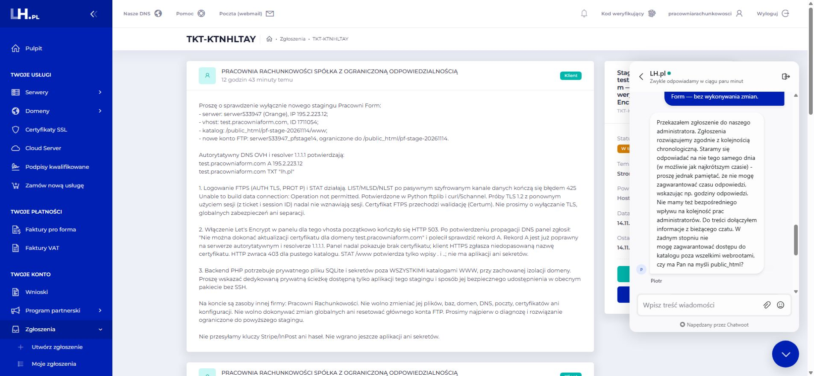

# LH: wynik Live Chat i gotowy odbiór runtime — 14.11.2026

Realizacja [polecenia w PR #28](https://github.com/pracowniarachunkowosci-debug/form/pull/28#issuecomment-6877154112), na tej samej gałęzi. Punkt odniesienia aplikacji: `9cb6100e6368c125e9fc6cbde6958496838c490d`.

**Wynik: eskalacja potwierdzona przez LH; wdrożenie nadal NO-GO.** Nie ma jeszcze ścieżki prywatnego runtime ani potwierdzonych praw/izolacji, więc nie wykonano uploadu aplikacji, sekretów ani SQLite na hosting. Nie jest to odmowa techniczna LH — administrator jeszcze nie odpowiedział.

## Rzeczywista odpowiedź Live Chat

Rozmowa 14.11.2026 około 13:23–13:40 Europe/Warsaw, konsultant **Piotr**, w kontekście otwartego [TKT-KTNHLTAY](https://www.lh.pl/panel/helpdesk/ticket/9235).

- Poprosiłem o prywatny katalog dla **test.pracowniaform.com / vhost 1711054 / serwer533947**, poza całym `public_html` i pozostałymi publicznymi mapowaniami, z rozdzielonym `config/` readonly i `data/` writable dla FPM, bez nadawania zapisu HOME lub zmian innych vhostów.
- LH zapytało, które z trzech zgłoszeń/aktualizacji jest aktualne. Potwierdziłem ostatnią aktualizację z 13:00 w tym samym TKT; wcześniejsze problemy FTPS i SSL są rozwiązane. Prośba nie dotyczy nowych zmian SSL/DNS.
- Piotr potwierdził: **„Przekazałem zgłoszenie do naszego administratora.”** Potwierdził też dołączenie informacji z czatu. Sprawy są obsługiwane chronologicznie; LH stara się odpowiadać tego samego dnia, ale konsultant **nie zagwarantował terminu ani możliwości udostępnienia katalogu**.
- Na pytanie o webroot doprecyzowałem: poza **całym** `public_html`, bez aliasu/symlinka przez host techniczny lub inny vhost. Wymagamy dokładnej ścieżki, praw tylko stagingu, trwałości/backup i bezpiecznego dostarczenia prywatnego JSON. Jeśli model nie jest wspierany, LH ma podać jeden wspierany wariant do decyzji właściciela, bez samodzielnej zmiany usługi.
- Nie było żądania weryfikacji właściciela. Nie odczytywałem ani nie przekazywałem kodów weryfikacyjnych. Zgłoszenia i rozmowy nie zamknąłem; karta pozostaje otwarta do kontynuacji.

W repozytorium pozostaje opis odpowiedzi i screenshot; techniczny eksport widgetu czatu został wyłączony z publikacji.

## Wykonane niezależnie od LH

1. [Sonda odbiorcza i instrukcja](LH_RUNTIME_PROBE.md): krótka ważność, hash tokena, HTTPS i dokładny host, odczyt nonsensytywnego config, odmowa jego zapisu, własny plik create/read/write/rename/delete, rzeczywiste SQLite DELETE journal i WAL/SHM, rollback/commit oraz cleanup wyłącznie własnych plików. Placeholder prywatnej ścieżki pozostaje nieuzupełniony.
2. [Szablon ochrony stagingu i weryfikator](LH_STAGING_ACCESS.md): Basic Auth, host techniczny zablokowany, noindex/no-store; wyjątek tylko dla dokładnego POST webhooka. Weryfikator 21 przypadków nie śledzi przekierowań i nie wysyła hasła poza HTTPS stagingu. **Szablon nie jest zainstalowany; Apache/LH UNRUN.**
3. Niezależny przegląd wykrył brak negatywnego testu POST do innego API. Dodano ten przypadek, POST do root i zakodowaną alternatywę ścieżki webhooka oraz regresję wykrywającą zbyt szeroki wyjątek.

## Testy i granice wyniku

| Kontrola | Wynik i środowisko |
| --- | --- |
| Sonda runtime | **30/30 PASS lokalnie** + lint PHP; prawdziwe lokalne operacje plikowe/SQLite, SAPI FPM i dodatni readonly ACL jawnie modelowane. Fixture’y posprzątane. |
| Weryfikator HTTP | **7/7 PASS offline**, w tym ochrona danych logowania i regresja zbyt szerokiego POST. To nie uruchomienie 21 żądań na LH. |
| Narzędzia propozycji stagingu/Actions | **14/14 PASS lokalnie**; blokady uploadu i workflow zachowane. |
| Checkout Sandbox | **PASS offline**: ceny/progi, rezerwacje, podpisy, idempotencja i cykl płatności na fixture’ach. Bez połączenia ze Stripe. |
| Live gates / locker / InPost MOCK | **PASS offline**, w tym bramki prawne/Live, walidacja punktu, zapis adresu testowego i dostawa. |
| Aplikacja i propozycja Actions względem 9cb6100 | **Bez zmian** w API, katalogu, cenach, SKU, stanach, wyglądzie, fotografiach i `ops/github`. |
| Prywatny runtime na LH | **BLOCKED** — brak odpowiedzi administratora ze ścieżką i prawami. |
| Świeży build 9cb6100, upload i runtime config | **NOT RUN**, zgodnie z warunkiem odbioru infrastruktury. Starszy ZIP 6ea1559 nie został użyty. |
| Stripe karta/BLIK, podpisany webhook i stan SKU na LH | **NOT RUN**; nie zastępujemy tego wynikiem lokalnym. |
| InPost Sandbox / rzeczywista mapa | **BLOCKED**, nadal zależne od F60AADBC18; pozostaje jawny MOCK. |
| Viewporty LH 320/360/390/430 i fizyczny telefon | **NOT RUN**, aplikacji nie ma jeszcze na stagingu. |

## Jeden następny krok

Odpowiedź administratora w TKT-KTNHLTAY: dokładna prywatna ścieżka, prawa/izolacja i bezpieczny kanał dostarczenia konfiguracji. Wtedy uruchamiamy przygotowany odbiór FPM. Po runtime PASS **i** potwierdzeniu braku publicznych mapowań można kontynuować już zatwierdzony staging dokładnego wydania 9cb6100, zaczynając od ochrony HTTP i ponownej inwentaryzacji WWW.

Jeżeli administrator jednoznacznie odmówi takiej izolacji w obecnym pakiecie, rekomendowana alternatywa to **osobne środowisko hostingowe wyłącznie dla Pracowni Form**, z potwierdzonym prywatnym katalogiem i odrębną tożsamością FPM. Wariant i koszt musi wskazać LH do decyzji właściciela; niczego nie zamówiono. MySQL nie usuwa wymogu prywatnego przechowania kluczy.

Nie powtarzano diagnostyki DNS/SSL, nie zmieniano hostingu, domen, poczty, certyfikatów ani zasobów Pracowni Rachunkowości. Bez merge, produkcji, Stripe Live, prawdziwych płatności/przesyłek i aktywacji Actions.
