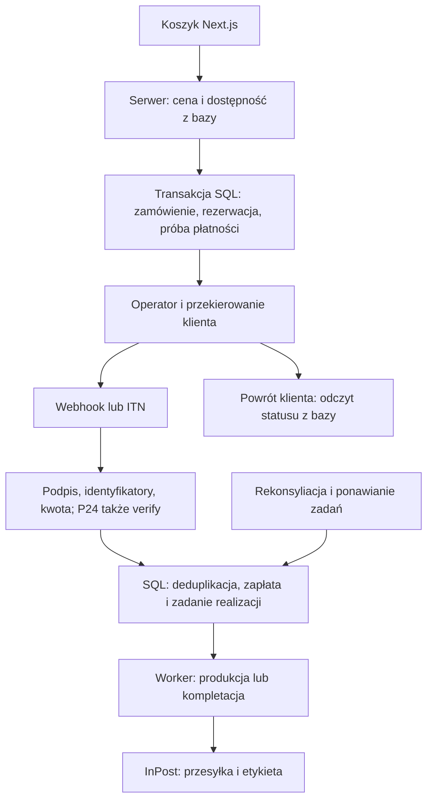

# Płatności dla Pracowni Form na Next.js i Vercelu

Stan źródeł: **2 listopada 2026**. Uzupełnienie [draft PR #7](https://github.com/pracowniarachunkowosci-debug/form/pull/7) i [komentarza o IP oraz Autopay](https://github.com/pracowniarachunkowosci-debug/form/pull/7#issuecomment-6589517166). Analiza dokumentacji i kosztów; nie wykonano integracji, testowych transakcji ani kontaktu z operatorami.

## 1. Rekomendacja i granice decyzji

**Dla wariantu Next.js + Vercel rekomenduję na start Stripe Checkout.** Przy zadanych priorytetach przeważają oficjalny SDK i przykład Next.js, dobrze opisane podpisy, ponowienia i idempotencja oraz brak obowiązkowego stałego IP w standardowym dostępie do API. Autopay Standard pozostaje pierwszym kandydatem do obniżenia kosztów po kwalifikacji technicznej. Bezpośrednie P24 jest trzecią opcją do czasu rozstrzygnięcia dostępu z Vercela.

To rekomendacja **operatora dla Next.js**, nie odwrócenie wcześniejszej rekomendacji platformy WooCommerce w [raporcie Issue #6](STORE_TCO_NEXT_VS_WOO.md). Żaden operator nie dostarcza brakującego magazynu, panelu produkcji i bezpiecznej maszyny stanów zamówień. Nie zmieniamy zatwierdzonego WINTER AFTER DARK R04. Koszyk i strony statusów mogą zachować R04; wygląd zewnętrznej strony płatności zależy od możliwości brandingu operatora.

Przy 100 płatnościach po 78 zł miesięcznie i miksie 70% BLIK / 20% kart EOG standard / 10% przelewów Stripe kosztuje **93,70 zł/mies. więcej niż Autopay**. To równowartość około 37 minut pracy przy umownej stawce 150 zł/h. Jest to porównanie ekonomiczne, nie dowód, że Stripe faktycznie oszczędzi tyle czasu. Przy 300 płatnościach różnica rośnie do 281,10 zł/mies.; wtedy ponowna ocena Autopay ma większą wagę.

**Warunek zmiany rekomendacji na Autopay:** pisemne potwierdzenie działania inicjacji, statusów i zwrotów bez stałego IP, uzgodnione finansowanie zwrotów oraz pozytywne testy duplikatów, opóźnionego ITN i zwrotów częściowych. Po spełnieniu tych warunków i wykazaniu niższego kosztu utrzymania można wybrać Autopay bez opierania decyzji na promocji. Na dziś nie ma dowodów pozwalających uznać jego adapter za równie tani w utrzymaniu jak Stripe.

Oznaczenia w raporcie: **fakt** = oficjalne źródło; **założenie** = jawny parametr obliczeń/projektu; **do potwierdzenia** = brak rozstrzygającej dokumentacji lub sprzeczność. Nie przypisujemy operatorom zmierzonej dostępności ani SLA: nie przeprowadzono pomiarów, audytu bezpieczeństwa ani testów sandbox.

## 2. Integracja i ograniczenia techniczne

Wspólny wniosek projektowy: użyć App Router Route Handlers w **Node.js runtime**, serwerowych sekretów i wywołań HTTPS. Standardowe interfejsy Request/Response umożliwiają obsługę tych protokołów; nie oznacza to certyfikacji integracji przez operatorów. [Next.js Route Handlers](https://nextjs.org/docs/app/api-reference/file-conventions/route).

| Obszar | Autopay | Przelewy24 bezpośrednio | Stripe Checkout |
| --- | --- | --- | --- |
| Start i przekierowanie | Paywall: POST z `ServiceID`, `OrderID`, kwotą i Hash | REST `transaction/register`, potem `/trnRequest/{TOKEN}` | Checkout Session przez oficjalny SDK Node; przekierowanie do Checkout |
| Autentyczność | Hash z uporządkowanych wartości i sekretu; nie dowolny HMAC | Basic Auth oraz SHA-384 określonego JSON + CRC | Klucz API; webhook: `Stripe-Signature`, sekret endpointu, surowe body |
| Powiadomienie | ITN: POST `transactions`, Base64/XML; podpisana odpowiedź XML | `urlStatus`; następnie obowiązkowe `transaction/verify` | Webhooki; SDK weryfikuje podpis |
| Duplikaty | Unikalność ServiceID/OrderID; refund `MessageID` deduplikuje ponowienie | Unikalny `sessionId`; refund `requestId`/`refundsUuid`, błędy duplikatu | Klucze idempotencji POST oraz identyfikatory zdarzeń |
| Status i brak sukcesu | PENDING/SUCCESS/FAILURE, API `transactionStatus` | Callback tylko o sukcesie; odczyt `transaction/by/sessionId`; `timeLimit` 0–99 min | Sesja i płatność mają odrębne statusy; metody asynchroniczne wymagają obsługi późniejszego sukcesu/porażki |
| Zwroty | `transactionRefund`, pełne i częściowe, wymagane środki w saldzie | `transaction/refund`, kwota w groszach, wynik asynchroniczny | API/panel, pełne i częściowe, także stany pending/failed |
| Sandbox i dokumentacja | Dokumentacja publiczna, konfiguracja testowa | Publiczny REST/OpenAPI, osobny sandbox | Publiczny SDK, przykład Next.js, testowe środowiska i narzędzia webhook |

Źródła protokołów: [Autopay](https://developers.autopay.pl/online/dokumentacja), [P24 REST/OpenAPI 1.0.18](https://developers.przelewy24.pl/yaml/pl_documentation_1.0.yaml), [Stripe Next.js](https://docs.stripe.com/checkout/quickstart?client=next), [webhooki Stripe](https://docs.stripe.com/webhooks), [idempotencja Stripe](https://docs.stripe.com/api/idempotent_requests), [zwroty Stripe](https://docs.stripe.com/refunds), [realizacja Checkout](https://docs.stripe.com/checkout/fulfillment.md?ui=full-page). Przejrzano dokumentację, nie aktywowano sandboxów. Dostęp P24 wymaga procedury opisanej w [instrukcji środowiska testowego](https://www.przelewy24.pl/centrum-pomocy/wsparcie-techniczne-api/jak-zalozyc-srodowisko-testowe).

Konsekwencje dla naszego adaptera — **zalecenia implementacyjne**:

- Autopay: parser XML bez DTD/encji zewnętrznych, limity rozmiaru, dokładna kolejność pól Hash i zasady pomijania pól opcjonalnych. Nie podpisywać całego XML własnym algorytmem. ITN potwierdzać dopiero po trwałym zapisie. Identyfikator próby płatności oddzielić od numeru zamówienia.
- P24: nie traktować samego callbacku jako zakończonego rozliczenia. Trwale zapisać odbiór, zweryfikować podpis i dane, wykonać `verify`, dopiero potem oznaczyć zapłatę. Przy niedostępności API utrzymywać stan oczekujący i ponawiać weryfikację. Schematów podpisu inicjacji, callbacku i weryfikacji nie wolno utożsamiać.
- Stripe: w Route Handler odczytać surowe body przed parsowaniem JSON. `checkout.session.completed` nie zawsze oznacza opłacenie; sprawdzać `payment_status` i zdarzenia metod asynchronicznych. SDK ogranicza liczbę własnych elementów kryptograficznych, ale nie zastępuje walidacji kwoty ani bazy zamówień.
- Wszystkie: ponowienie żądania przez klienta, timeout odpowiedzi i ponowiony webhook nie mogą tworzyć kolejnej zapłaty, wysyłki ani zwrotu. Stripe przechowuje klucze API co najmniej 24 h, a webhooki produkcyjne ponawia do trzech dni; deduplikacja w naszej bazie musi działać niezależnie od tych okien. [Idempotencja](https://docs.stripe.com/api/idempotent_requests), [dostarczanie webhooków](https://docs.stripe.com/webhooks).

### IP: najważniejsza niewiadoma dla Vercela

**Fakt:** Vercel domyślnie ma zmienne IP wyjściowe. Stały adres domeny strony ani DNS nie rozwiązują whitelistingu połączeń wychodzących. [Vercel — allowlisting](https://vercel.com/kb/guide/how-to-allowlist-deployment-ip-address).

| Operator | Co ustalono | Skutek dla decyzji |
| --- | --- | --- |
| Autopay | Podstawowa konfiguracja Paywall/ITN nie wymienia stałego IP sklepu. Inne części dokumentacji dotyczą IP integratorów/marketplace | To brak potwierdzonego obowiązku, **nie gwarancja**. Osobno potwierdzić inicjację, status, zwroty i środowiska |
| P24 | Oficjalna pomoc API poleca wpisanie statycznego IP serwera | Realna przeszkoda dla domyślnego Vercela. Konieczne potwierdzenie dopuszczalnego dostępu dynamicznego albo koszt stałego egress |
| Stripe | Ograniczenia kluczy według IP są opcjonalną polityką dostępu | Standardowy model bez obowiązkowego stałego IP; własna polityka ograniczająca klucz może tę sytuację zmienić |

Źródła: [Autopay — konfiguracja](https://developers.autopay.pl/online/dokumentacja), [P24 — niedziałający klucz API](https://www.przelewy24.pl/centrum-pomocy/wsparcie-techniczne-api/klucz-api-nie-dziala-co-zrobic), [Stripe — klucze i access policies](https://docs.stripe.com/keys).

Wzmianka o wildcardzie `%` w recenzji pozostaje **niepotwierdzoną hipotezą integracyjną**. Nie zalecamy jego ustawienia ani zakładania, że wyłączenie filtrowania jest wspierane. Potrzebna pisemna odpowiedź P24 o zakresie, odpowiedzialności i dodatkowych zabezpieczeniach.

Vercel Static IPs na Pro/Enterprise kosztuje **100 USD/projekt/mies. plus transfer**, oprócz planu Pro. Dotyczy ruchu wychodzącego, jest powiązany z regionami i nie obejmuje Edge Routing Middleware; współdzielona pula nie jest dedykowaną tożsamością aplikacji. [Static IPs](https://vercel.com/docs/networking/static-ips). Przy założeniu 4 PLN/USD: **+400 zł/mies., +4 800 zł/12 mies., +14 400 zł/36 mies.**, przed transferem i odpowiednim VAT. Nie kupować tego dodatku „na wszelki wypadek”.

Alternatywą projektową jest mały backend/proxy ze stałym IP. To dodatkowy serwer do aktualizacji, ochrony sekretów, monitorowania i odzyskiwania. Nie wyceniamy go jako darmowego obejścia ani nie rekomendujemy go dla oszczędności 1 zł/mies. między P24 a Autopay przy koszyku 78 zł.

## 3. Koszty bez promocji

Kwota koszyka to **cała kwota pobrana**, wraz z dostawą, jeżeli jest płatna. Stawki opublikowane nie są indywidualną ofertą dla spółki. Dla usług infrastruktury zachowujemy podejście netto przy odliczalnym VAT z modelu Issue #6; opłaty płatnicze liczymy tak, jak opublikowano. Nie doliczamy automatycznie 23% do każdej prowizji. Ceny i podatki z podpisanej umowy/faktury mają pierwszeństwo.

| Operator/metoda | Stawka | Koszyk 39 zł | 78 zł | 156 zł |
| --- | ---: | ---: | ---: | ---: |
| Autopay Standard: BLIK | 1,25% + 0,34 zł | 0,83 | 1,32 | 2,29 |
| Autopay Standard: karta, oferta podstawowa* | 1,25% + 0,34 zł | 0,83 | 1,32 | 2,29 |
| Autopay Standard: pay-by-link | 1,25% + 0,34 zł | 0,83 | 1,32 | 2,29 |
| P24: BLIK | 1,29% + 0,30 zł | 0,81 | 1,31 | 2,32 |
| P24: karta 3DS, oferta podstawowa* | 1,29% + 0,30 zł | 0,81 | 1,31 | 2,32 |
| P24: przelew online | 1,29% + 0,30 zł | 0,81 | 1,31 | 2,32 |
| Stripe: BLIK | 1,6% + 1 zł | 1,62 | 2,25 | 3,50 |
| Stripe: standardowa karta EOG | 1,5% + 1 zł | 1,59 | 2,17 | 3,34 |
| Stripe: P24 jako metoda przelewu | 1,9% + 1 zł | 1,74 | 2,48 | 3,96 |

Źródła cen: [Autopay Standard](https://autopay.pl/oferta/platnosci-online), [oferta P24](https://www.przelewy24.pl/bramka-platnicza), [Stripe Polska](https://stripe.com/en-pl/pricing), [lokalne metody Stripe](https://stripe.com/en-pl/pricing/local-payment-methods). P24 wewnątrz Stripe to **inna taryfa i integracja** niż bezpośrednia umowa z P24.

Zaokrąglenia: dla Stripe/Autopay przyjęto HALF_UP do grosza od pojedynczej transakcji. Dla P24 część procentowa jest zaokrąglana **w górę**, następnie doliczane 0,30 zł — zgodnie z [wzorem umowy, załącznik 4, przypis 1](https://www.przelewy24.pl/storage/app/media/dokumenty/przelewy24-wzor-umowy.pdf). Dla kart przyjęto konserwatywnie tę samą zasadę; odrębne warunki kartowe wymagają potwierdzenia. Przykład: 39 × 1,29% = 0,5031 → 0,51 + 0,30 = **0,81 zł**. Koryguje to wcześniejsze 0,80/2,31 zł w kalkulatorze dla 39/156 zł; wynik dla 78 zł się nie zmienia.

*Nie rozszerzać podstawowej stawki kartowej na dowolne karty zagraniczne/firmowe. Stripe publikuje 1,9% + 1 zł dla premium EOG, 2,5% + 1 zł dla UK, 3,25% + 1 zł dla pozostałych międzynarodowych oraz +2% przy konwersji. Dla Autopay/P24 uzyskać ofertę obejmującą CZ/ES, waluty rozliczenia, karty spoza EOG i FX. BLIK i polski pay-by-link nie zastąpią lokalnych metod za granicą. [Stripe pricing](https://stripe.com/en-pl/pricing).

| Dodatkowa pozycja | Autopay | P24 | Stripe |
| --- | --- | --- | --- |
| Aktywacja w bazie | 49 zł dla działalności rejestrowanej | 59 zł; możliwy zwrot po 10 transakcjach w 2 miesiące | 0 zł |
| Abonament podstawowy | Standard: rozliczenie transakcyjne | 0 zł | Standard Payments: 0 zł |
| Obsługa zwrotu | Oferta: 0 zł | Krajowy: 0 zł | Standardowe karty/BLIK/P24: bez dodatkowej opłaty; inne przelewy mogą mieć opłatę |
| Pierwotna prowizja po zwrocie | Nie potwierdzono oddania; budżet zachowuje koszt | Nie potwierdzono oddania; budżet zachowuje koszt | Nie jest oddawana |
| Wypłaty PLN | Oferta: 0 zł | Oferta: 4/mies. bezpłatne, kolejne 0,99 zł | W modelu zwykłe rozliczenie; bez opcjonalnej wypłaty natychmiastowej |
| Stałe IP | Potwierdzić zakres API; w bazie 0 zł warunkowo | 0 zł tylko po potwierdzeniu dopuszczalnej ścieżki; alternatywnie +100 USD/mies. | Brak obligatoryjnego dodatku w standardowym dostępie |

Źródła: [Autopay — cennik](https://autopay.pl/oferta/platnosci-online), [P24 — oferta](https://www.przelewy24.pl/bramka-platnicza), [Stripe — pricing](https://stripe.com/en-pl/pricing), [Stripe — lokalne metody](https://stripe.com/en-pl/pricing/local-payment-methods).

**Rozbieżność P24:** publiczny wzór umowy podaje pierwszą wypłatę dziennie za 0 zł i kolejne po 2 zł, podczas gdy oferta powyżej ma limit miesięczny. Nie łączymy obu taryf; przed umową uzyskać właściwą TOiP. Bazowy koszt zakłada najwyżej cztery wypłaty PLN miesięcznie. Przy 20 wypłatach według oferty dopłata wyniesie 15,84 zł/mies. Opłaty chargeback, niestandardowe rozliczenia walutowe i indywidualne rezerwy środków wymagają osobnego potwierdzenia; nie są opłatą za zwykły zwrot. [Wzór umowy P24](https://www.przelewy24.pl/storage/app/media/dokumenty/przelewy24-wzor-umowy.pdf).

Autopay oferuje też **Starter: 29,99 zł/mies. przy płatności rocznej 359,88 zł**, 0% do 5 500 zł obrotu miesięcznie i 1,1% powyżej progu. To alternatywa abonamentowa, nie przyjęta baza. Trzeba potwierdzić naliczanie nadwyżki, metody, aktywację i łączenie promocji. [Autopay — plany](https://autopay.pl/oferta/platnosci-online).

### Porównywalny koszt technologii przez 12 i 36 miesięcy

**Założenia:** 100 opłaconych zamówień/mies. × 78 zł, miks 70/20/10, bez zwrotów, promocji, nadwyżek i wzrostu cen. Wspólne 170 zł/mies. pochodzi z modelu Issue #6: Vercel Pro 20 USD + budżet bazy 20 USD, kurs planistyczny 4 PLN/USD, kopie 10 zł. To nie bieżący kurs ani potwierdzony rachunek za bazę. [Vercel pricing](https://vercel.com/pricing), [założenia modelu](store-tco/assumptions.json).

| Wariant Next.js | Prowizje/mies. | Aktywacja | Technologia 12 mies. | Technologia 36 mies. |
| --- | ---: | ---: | ---: | ---: |
| Stripe | 225,70 | 0 | 4 748,40 | 14 245,20 |
| Autopay, dynamiczny egress potwierdzony | 132,00 | 49 | 3 673,00 | 10 921,00 |
| P24, dopuszczalny dynamiczny egress potwierdzony | 131,00 | 59 | 3 671,00 | 10 895,00 |
| P24 z Vercel Static IPs | 131,00 | 59 | 8 471,00 + transfer | 25 295,00 + transfer |

Wzór: `(170 + prowizje miesięczne + dodatek IP) × liczba miesięcy + aktywacja`. Stripe: `70 × 2,25 + 20 × 2,17 + 10 × 2,48 = 225,70`. To **koszt technologii, nie pełny TCO z pracą**. Nie doliczać tych tabel ponownie do całego TCO w głównym raporcie. Przy rozliczaniu Neon niższym o 15 USD/mies. każdy wariant maleje identycznie o 720/2 160 zł; ta oszczędność nie rozwiązuje problemu IP.

Przy referencyjnym dodatkowym nakładzie Autopay 24 h × 150 zł/h oraz aktywacji 49 zł, sama oszczędność prowizji względem Stripe przy 100 zamówieniach wyrównuje nakład po około **39 miesiącach**: `(3 600 + 49) / 93,70`. Przy 300 zamówieniach około 13 miesięcy. To analiza wrażliwości przy niezmienionym utrzymaniu, nie prognoza faktycznych wydatków na wykonawcę.

## 4. Polska Bezgotówkowa w Autopay

**Informacje od właściciela:** sprzedawcą jest Pracownia Rachunkowości sp. z o.o., konto firmowe w Alior Banku, brak umowy z operatorem online w ostatnich 12 miesiącach. Daje to podstawę do sprawdzenia kwalifikacji, nie automatyczne zakwalifikowanie. Zweryfikować także wcześniejsze uczestnictwo spółki/NIP w programie e-commerce i faktyczne przyjmowanie płatności online. Udział jest jednorazowy w tym kanale, wymaga kart i umowy co najmniej na 12 miesięcy. [Zasady Fundacji, wersja 15.0, rozdz. 2.3](https://api.polskabezgotowkowa.pl/uploads/Wyciag_z_Zasad_Operacyjnych_15_0_dla_akceptantow_standardowych_w_kanale_e_Commerce_72ad2b6d99.pdf).

Autopay reklamuje 0 zł aktywacji i płatności: **karty Visa/Mastercard — 12 miesięcy lub 50 tys. zł; BLIK/pay-by-link — osobna promocja Autopay, również do 12 miesięcy lub 50 tys. zł**. To dwie podstawy i limity, nie nieograniczony rok wszystkich płatności za darmo. [Oferta programu](https://autopay.pl/oferta/polska-bezgotowkowa).

[Warunki promocji Autopay](https://autopay.pl/storage/pdf/polska_bezgotowkowa_warunki_promocji.pdf?v=orig) wymagają kwalifikacji, przewidują okres oznaczony 12 miesięcy oraz w określonych sytuacjach karę 500 zł. Dokument opisuje dofinansowanie części kartowej do 1%, dlatego końcową efektywną stawkę 0 zł, dopłaty i zakres kart trzeba potwierdzić w indywidualnych warunkach. Zbadać również moment rozpoczęcia limitów, prowizję po ich wyczerpaniu i zasady rozwiązania umowy. Nie zakładamy zwolnienia z opłat za spory ani wszystkie usługi dodatkowe.

Nie znaleziono w sprawdzonych zasadach wymogu przenoszenia rachunku z Aliora. Weryfikacja rachunku należącego do spółki, KYC i uprawnień reprezentacji należy do operatora. Promocja jest potencjalnym bonusem i **nie zmienia rekomendacji bazowej**. Dla porównania P24 także oferuje program dotyczący kart; nie przyjmujemy automatycznie tych samych warunków dla BLIK. [P24 — Polska Bezgotówkowa](https://www.przelewy24.pl/oferta/polska-bezgotowkowa).

## 5. Docelowy przepływ i trwałość danych — projekt, nie implementacja

1. **Przed płatnością:** przeliczyć ceny, dostawę, rabaty i walutę po stronie serwera. Zapisać snapshot zamówienia i kwoty w groszach. Transakcja SQL blokuje odpowiedni SKU i atomowo rezerwuje stan z terminem wygaśnięcia. Dla druku na zamówienie rezerwować ograniczoną zdolność produkcyjną, nie fikcyjny stan wyrobu.
2. **Próba płatności:** zapisać unikalny identyfikator i klucz operacji przed wywołaniem operatora. Podwójne kliknięcie zwraca tę samą aktywną próbę. Sekrety pozostają na serwerze. Po timeout oznaczyć wynik jako nieznany i sprawdzić status; nie tworzyć od razu nowej próby, która mogłaby pobrać drugi raz.
3. **Odbiór:** publiczny HTTPS bez logowania użytkownika, za to z autentykacją protokołu operatora. Weryfikować podpis, sprzedawcę, środowisko, walutę, kwotę i powiązanie z próbą. Dla hashy własnych użyć porównania odpornego na analizę czasu. Nie logować sekretów ani pełnych danych płatniczych.
4. **Trwały inbox:** zapisać zdarzenie i klucz deduplikacji w SQL; ponowiony komunikat ma zwracać poprawne potwierdzenie bez kolejnej realizacji. ACK ma odpowiadać protokołowi operatora. P24 wymaga skutecznego `verify` przed stanem paid; jeśli API nie odpowiada, utrwalić zadanie ponowienia. Nie wykonywać etykiet i e-maili przed potwierdzeniem webhooka.
5. **Atomowa zmiana stanu:** w jednej transakcji bazy oznaczyć zapłatę, rozliczyć rezerwację i dodać zadanie do outbox. Unikalność zadania realizacji chroni przed dwoma różnymi zdarzeniami dotyczącymi tej samej zapłaty. Starsze PENDING/FAILURE nie cofają zaakceptowanego sukcesu.
6. **Rekonsyliacja:** okresowo sprawdzać oczekujące/nieznane płatności i niedokończone zwroty. Powrót klienta, zamknięcie karty, przycisk „anuluj” i lokalny timeout nie dowodzą nieopłacenia. Rezerwację zwalniać zgodnie z uzgodnioną polityką czasu; późniejszy sukces wymaga ponownej kontroli stanu. Przy braku towaru: blokada realizacji i obsługa ręczna/zwrot, nigdy sprzedaż ujemnego stanu.
7. **Realizacja:** worker pobiera zadania z blokadą/lease, zapisuje próbę, wynik i czas ponowienia. Dopiero opłacone zamówienie trafia do kompletacji lub kolejki druku. InPost ma osobny lokalny identyfikator zlecenia; po timeout tworzenia przesyłki najpierw uzgodnić wynik z API, aby nie generować dwóch etykiet. Nie zakładamy idempotencji ShipX bez osobnej weryfikacji dokumentacji w etapie wdrożenia.
8. **Zwroty:** panel z uprawnieniami, MFA i audytem. SQL blokuje równoległe żądania i pilnuje, aby suma zwrotów wykonanych oraz zarezerwowanych nie przekroczyła zapłaty. Stan requested/processing/completed/failed jest oddzielny od zamówienia. Zwrot pieniędzy sam w sobie nie przywraca towaru do magazynu; powrót i kontrola produktu to osobny proces.

| Gdzie | Odpowiedzialność |
| --- | --- |
| Vercel Functions | Checkout API, callbacki, walidacja, podpisy, status dla klienta, panel, krótkie partie zadań |
| Trwała relacyjna baza, np. PostgreSQL | SKU, stany/rezerwacje, snapshoty zamówień, próby płatności, inbox/outbox, refund ledger, produkcja, identyfikatory przesyłek, audyt |
| Scheduler + worker | Ponowienia z backoff, uzgadnianie statusów, wygaszanie rezerwacji, nadzór nad zaległościami |
| Dodatkowe usługi niezbędne operacyjnie | Baza z kopią i sprawdzonym odtwarzaniem; kanał e-mail transakcyjnego; monitoring/alerty; później umowy operatora i InPost |
| Opcjonalne, nie domyślne zakupy | Osobny broker/Redis, Workflow/Queues, stałe IP; dopiero gdy wymagania uzasadnią ich koszt |

Dane finansowe i blokady **nie mogą żyć wyłącznie w pamięci funkcji, cache ani `/tmp`**. Bazę umieścić blisko regionu funkcji i dobrać pulę połączeń. Nie trzymać transakcji SQL podczas oczekiwania na zewnętrzne API.

Cron Vercela może uruchamiać worker, ale nie zapewnia samodzielnie trwałej kolejki ani automatycznego ponowienia nieudanego wywołania. Zadania, lease i próby przechowujemy w SQL; następne wywołanie ma nadrobić zaległości, a monitoring wykryć brak uruchomień. Nie polegać na pracy „w tle” po zakończeniu requestu. [Vercel — zarządzanie Cron Jobs](https://vercel.com/docs/cron-jobs/manage-cron-jobs).

## 6. Ryzyko, praca i przyszły odbiór

Ocena własna dotyczy **ryzyka integracji**, nie ogólnej wiarygodności instytucji. Brak danych do uczciwego rankingu rzeczywistego uptime operatorów.

| Kryterium | Autopay | P24 | Stripe |
| --- | --- | --- | --- |
| Nakład adaptera i testów protokołu | Średni: XML, Hash, ACK | Średni: rejestracja i verify | Najmniejszy: SDK i przykład Next.js |
| Ryzyko infrastruktury Vercel | Średnie do potwierdzenia API | Wysokie do rozstrzygnięcia IP | Niskie przy standardowej polityce kluczy |
| Ryzyko błędu podpisu/duplikatu | Wymaga większej części własnego kodu | Własne schematy SHA-384 i stan verify | SDK redukuje zakres; deduplikacja biznesowa nadal własna |
| Zwroty operacyjne | Saldo i dostęp API do uzgodnienia | Status asynchroniczny i sieć do uzgodnienia | Dobrze opisane, również niepowodzenia |
| Koszt prowizji przy małym koszyku | Niski | Niski | Wyższy |
| Ekspansja zagraniczna | Warunki walut/kart do uzgodnienia | Warunki walut/kart do uzgodnienia | Szeroki zakres opisany; dopłaty FX/karty zagraniczne |

**Szacunki, nie oferty:** przy gotowym wspólnym modelu zamówień, rezerwacji i outbox adapter z testami: Stripe **24–40 h**, Autopay **40–72 h**, P24 **40–72 h** po rozstrzygnięciu sieci. Referencyjnie 32/56/56 h, czyli Autopay/P24 +24 h względem Stripe. Wspólny backend nie jest objęty tymi liczbami; jest osobno w szerokim TCO Issue #6. KYC, oczekiwanie na odpowiedzi i prace proxy są poza widełkami. Czas utrzymania sklepu w głównym modelu pozostaje budżetem, nie udowodnioną przewagą godzinową któregoś operatora.

Przyszły plan, **dopiero po zatwierdzeniu wyboru i zakresu implementacji**:

1. Uzgodnić taryfę, warunki zwrotów i ścieżkę sieci; potwierdzić brak blokady dla planowanej sprzedaży i druku na zamówienie. Właściciel podejmuje decyzję o umowie.
2. Przygotować bazę, stany, rezerwacje, inbox/outbox i interfejs adaptera. Zachować R04, działające formularze, SEO, zgody i analitykę; checkout nie może zależeć od zgody marketingowej.
3. Zintegrować tylko jeden operator w sandboxie. Osobne sekrety test/production, najmniejsze uprawnienia, rotacja, MFA i limity requestów; brak danych kart w aplikacji.
4. Przetestować BLIK/kartę/przelew: sukces, odmowę, anulowanie, porzucenie, timeout startu i statusu, niedostępność callbacku, duplikat, zły podpis/kwotę, zdarzenia w złej kolejności, utracony powrót, wygasłą rezerwację i ostatnią sztukę kupowaną równolegle. Pełny i dwa częściowe zwroty, ich duplikaty oraz brak salda. Testy dostępu ze wszystkich docelowych regionów Vercela.
5. Odbiór odzyskiwania bazy i zaległych zadań, ręcznej rekonsyliacji, monitoringu płatności/zwrotów oraz pojedynczej realizacji InPost. Osobna decyzja właściciela przed jakąkolwiek produkcją.

## 7. Pytania do operatorów — przygotowane, niewysłane

### Autopay

1. Czy zwykły sprzedawca z Next.js na Vercel Functions może korzystać ze zmiennego egress IP przy **Paywall, transactionStatus i transactionRefund**? Prosimy o odpowiedź osobno dla sandbox/produkcji i wszystkich regionów, bez zakładania modelu marketplace.
2. Jakie są dokładne reguły ponowienia inicjacji po timeout oraz retencja deduplikacji `MessageID` zwrotu? Czy można jednoznacznie odczytać wynik każdej nieznanej operacji?
3. Czy pełne i wielokrotne częściowe zwroty BLIK/kart/PBL są dostępne przez API w standardowej umowie? Jak zasilić saldo po wypłacie na Alior, jakie są terminy, limity i statusy końcowe?
4. Prosimy o TOiP: zaokrąglenia, zwrot pierwotnej prowizji, chargeback, karty zagraniczne/firmowe, EUR/CZK, FX oraz pełne warunki Starter. Jakie są SLA i ścieżka eskalacji niedostarczonego ITN?
5. Czy wskazana spółka/NIP kwalifikuje się do Polski Bezgotówkowej i osobnej promocji BLIK/PBL? Prosimy o potwierdzenie efektywnej stawki kart 0 zł, oddzielnych limitów, aktywacji, sankcji, terminu umowy i wymogów rachunku Alior.

### Przelewy24

1. Czy dla `register`, `verify`, odczytu statusu i `refund` stałe IP jest obligatoryjne? Czy istnieje oficjalnie wspierana konfiguracja dla dynamicznych IP Vercela, także sandbox i failover regionu? Czy `%` jest dopuszczalne umownie i jakie zabezpieczenia zastępują allowlistę?
2. Jakie są zasady ponawiania `register`/`verify` po timeout, retencja identyfikatorów i sposób rozpoznania już wykonanej operacji? Jakie potwierdzenie callbacku i harmonogram ponowień obowiązują przy chwilowej awarii verify?
3. Czy pełne i wielokrotne częściowe zwroty wszystkich trzech metod są dostępne w standardzie? Jak finansować je po wypłacie, obsłużyć odrzucenie i sprawdzić status po timeout; czy deduplikacja refund ma ograniczenie czasowe?
4. Prosimy o wiążącą TOiP: **4 wypłaty/mies. + 0,99 zł czy pierwsza dziennie + 2 zł**, zaokrąglenia kart, zwrot prowizji pierwotnej, chargeback, FX i reguły zwrotu aktywacji 59 zł. Jakie SLA i wsparcie techniczne obejmuje umowa?

Bez odpowiedzi nie oznaczać ryzyk IP i finansowania zwrotów jako zamkniętych. Rekomendacja nie stanowi zgody na zakup, otwarcie konta ani uruchomienie płatności.
