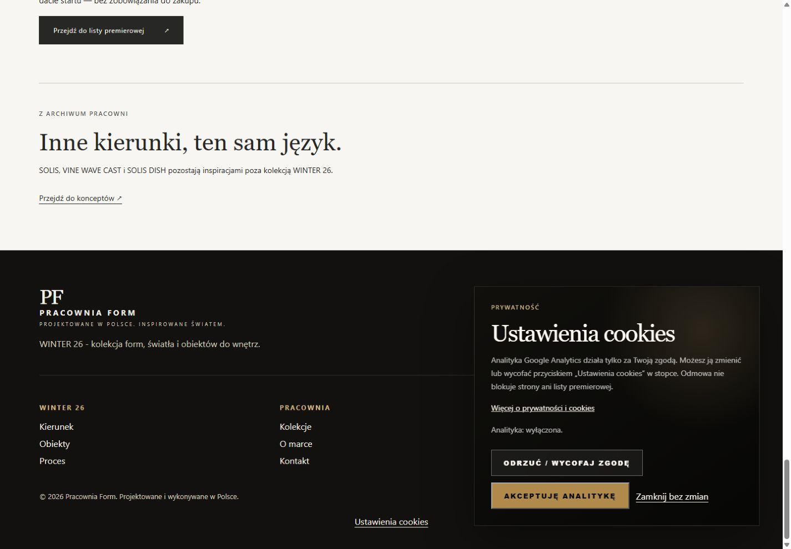
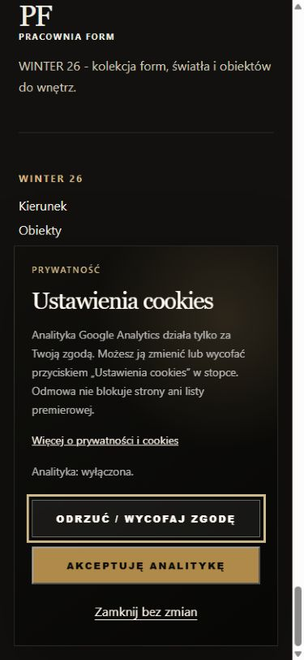

# PR #11 — uzupełnienie fazy A, 3 listopada 2026

Realizuje [recenzję](https://github.com/pracowniarachunkowosci-debug/form/pull/11#issuecomment-6608120252) i [decyzję o przyszłym hero](https://github.com/pracowniarachunkowosci-debug/form/pull/11#issuecomment-6615915478). To przygotowanie do odbioru, **NO-GO dla publikacji**. Pozostałe PR pozostają nietknięte.

## Wykonane teraz

1. Zasady listy opisują WINTER 26 bez zamówień i pre-orderu; nie zapowiadają Nord/Stone/Kintsugi jako tego pilota. Zachowano stare identyfikatory sekcji, aby nie zepsuć odnośników.
2. Dokumenty mają rzeczywistą datę przygotowania projektu 03.11.2026, wyraźnie odróżnioną od nieustalonej daty zatwierdzenia. Usunięto placeholder daty i stare lata 2025 w stopkach.
3. Każda z 10 stron ma „Ustawienia cookies” w stopce; polityka także w treści. Panel można otwierać wielokrotnie, odrzucić lub ponownie zaakceptować analitykę, zamknąć bez zmiany, zamknąć Escape; fokus wraca do przycisku otwierającego. Panel jest niemodalnym regionem, więc nie więzi klawiatury.
4. Cofnięcie ustawia `ga-disable-G-58YFJ2RHNZ`, przekazuje odmowę w Consent Mode i usuwa dostępne first-party cookies `_ga*`, `_gid`, `_gat*` dla hosta/domen nadrzędnych i ścieżek. Cookies innych usług pozostają. Po odświeżeniu z odmową skrypt GA nie jest pobierany. Cofnięcie w drugiej karcie działa przez zdarzenie `storage`. Nie resetuje formularza ani nie przeładowuje strony.
5. Prywatność obejmuje cele/podstawy, kategorie danych, Brevo, LH jako przyszły hosting, obecne GitHub/OVH, Google, kryteria retencji, transfery i zmianę zgody. Dane spółki niezmienione. Otwarte ustawienia kont opisane jako niepotwierdzone; nie deklarujemy kompletności prawnej na podstawie testu HTML.
6. Powstały [plan kontrolowanego testu Brevo](BREVO_ACCEPTANCE_PLAN.md), [operacyjny plan i decyzje GO/NO-GO](RELEASE_READINESS.md), [plan przyjęcia fotografii](PRODUCT_PHOTO_HANDOFF.md). Wysyłki, DNS/SSL i uploadu nie wykonano.

## Granice weryfikacji cookies

Zachowano istniejący identyfikator GA i domyślną odmowę; dodano wyłączenie funkcji reklamowych Google w `config`. Na kontakcie i prywatności, gdzie wcześniej nie było inicjalizatora GA, nie dodano nowego pomiaru, ale preferencje i cofnięcie są dostępne. Preferencja jest wspólna dla stron tego samego origin; apex i www mają oddzielny storage, dlatego plan migracji wymaga jednego hosta kanonicznego.

Usunięcie znacznika `<script>` nie usuwa uruchomionego kodu Google. Dlatego cofnięcie używa [oficjalnej flagi opt-out](https://developers.google.com/tag-platform/security/guides/privacy) przed aktualizacją zgody. Nie cofa żądań już wysłanych ani nie kasuje historycznych danych w GA. Skrypt załadowany przed cofnięciem może pozostać w pamięci; ponowna akceptacja nie dodaje drugiego znacznika. Błąd localStorage nie przerywa strony: nowa akceptacja nie uruchamia GA, użytkownik dostaje instrukcję usunięcia starej zgody w przeglądarce.

## Weryfikacja

- `node scripts/check_consent.cjs`: PASS. Realny kontroler wykonywany w VM bez sieci: brak zgody, akceptacja, duplikat akceptacji, odmowa, cofnięcie zapisanej akceptacji, odświeżenie, ponowna akceptacja, cofnięcie w drugiej karcie/usunięcie storage, błąd storage, selektywne usuwanie cookies, Escape/fokus oraz strony bez inicjalizatora GA.
- `python scripts/check_publication.py`: PASS. 10 stron, 271 lokalnych referencji, formularz Brevo niezmieniony, kontrolki cookies na każdej stronie, daty projektu, semantyka/SEO/linki. `main` i `header` WINTER porównane z zaakceptowanym `e054e60`: bez zmian. Pozostałe zachowanie `script.js` (menu, zainteresowania, reveal) zachowane.
- Browser QA i obrazy poniżej: otwarcie ze stopki i polityki, Escape/powrót fokusu, odmowa i odświeżenie bez skryptu Google; desktop 1440×1000, mobile 390×844 oraz 320×568 bez poziomego overflow. Na niskim ekranie panel przewija się, a zamknięcie pozostaje dostępne. Akceptację/wycofanie po akceptacji sprawdzono w VM, aby nie wysyłać testowych odsłon do produkcyjnego GA. Nowe zasady sprawdzono także w widoku mobilnym. Rzeczywiste testy Brevo pozostają niewykonane.

## Prywatność — decyzje merytoryczne właściciela

| Kwestia | Propozycja do akceptacji / dowód wymagany przed publikacją |
|---|---|
| Formalna data | Zatwierdzić wersję tekstu i datę wejścia w życie; data projektu nie jest zatwierdzeniem |
| Newsletter | Potwierdzić DOI, listę docelową, wypisanie, podmiot umowny Brevo i DPA; wiadomości marketingowe wymagają osobnej zgody od analityki |
| Retencja Brevo | Aktywne kontakty do rezygnacji/zakończenia listy; proponowany przegląd nieaktywnych co 12 miesięcy. Ustalić czas przechowywania dowodu zgody i listy blokującej; nie ustawiać masowego kasowania bez odbioru |
| GA | Rekomendacja: 2 miesiące danych użytkownika/zdarzeń, bez odnawiania okresu przy aktywności. To propozycja, nie odczyt konta. [Google opisuje opcje 2/14 miesięcy i odrębność raportów agregowanych](https://support.google.com/analytics/answer/7667196) |
| Korespondencja | Zatwierdzić harmonogram przeglądu/usuwania po zamknięciu sprawy, z wyjątkami dla roszczeń i obowiązków prawnych; nie deklarować arbitralnego okresu jako obowiązującego |
| LH/OVH | Potwierdzić umowy, okres logów oraz kopii, dostęp personelu i miejsce przetwarzania; 30-dniowy backup LH nie jest równoznaczny z 30-dniową retencją wszystkich danych |
| Transfery | Potwierdzić konkretne podmioty, podwykonawców i mechanizmy z umów; sama lokalizacja serwera nie rozstrzyga dostępu z państw trzecich |
| Kontakt | Potwierdzić istnienie i monitorowanie `kontakt@pracowniaform.com`, osobę odpowiedzialną i doręczenie testu; MX nie dowodzi istnienia skrzynki |

Źródła odczytane 03.11.2026: [UODO — obowiązek informacyjny i prawa](https://www.uodo.gov.pl/pl/493/2254), [Brevo — lokalizacja danych](https://help.brevo.com/hc/en-us/articles/360001005510-Data-storage-location), [Brevo — RODO/DPA](https://help.brevo.com/hc/en-us/articles/360001258744-How-does-Brevo-comply-with-the-GDPR), [Google — transfery](https://policies.google.com/privacy/frameworks). Brevo opisuje hosting we Francji/Niemczech i Google Cloud w Belgii; nie zamieniono tego w zapewnienie o braku wszelkich transferów dla używanego konta. Dokumentacja publiczna nie zastępuje weryfikacji umów i ustawień właściciela.

## Otwarte decyzje do odbioru

1. Dostarczenie realnych zdjęć i akceptacja hero z otwartą bombką po obróbce; obecny asset pozostaje bez produktu.
2. Zatwierdzenie dokumentów, daty, retencji i potwierdzenie działania skrzynki kontaktowej.
3. Osobna zgoda na kontrolowany test Brevo na wskazanych adresach; bez masowej wysyłki.
4. Uzyskanie odpowiedzi LH o poczcie i SSL oraz eksportu DNS/DKIM OVH; akceptacja wariantu przełączenia z rzeczywistym ryzykiem HTTPS.
5. Dopiero po zamknięciu bramek: osobna zgoda na dokładny commit/ZIP/hash, okno fazy B i rollback. Samo zaakceptowanie projektu wizualnego nie uruchamia wdrożenia.
