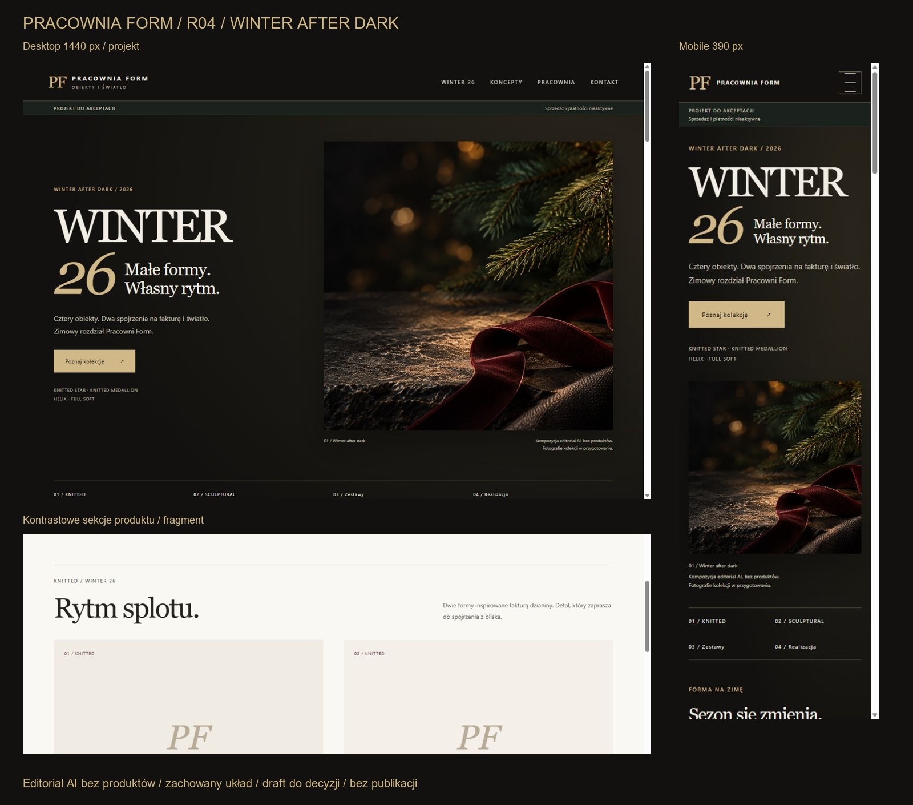
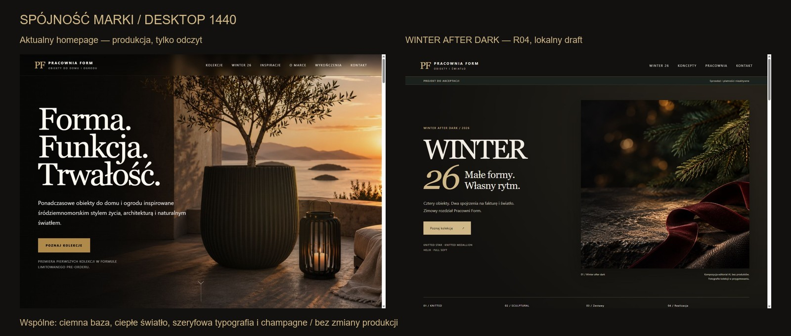
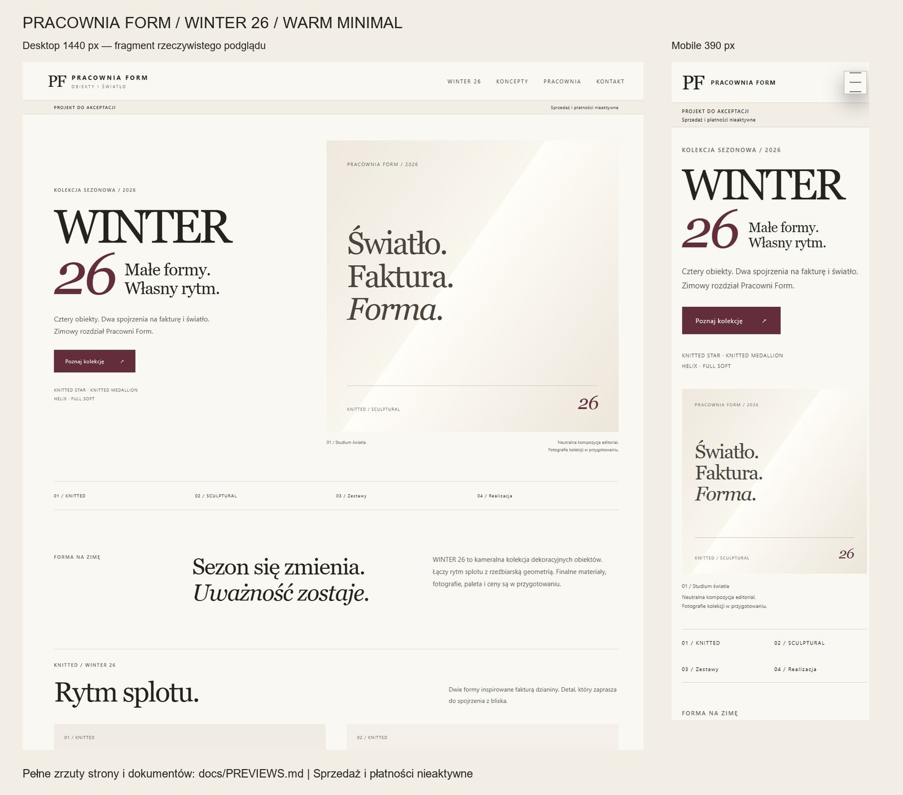
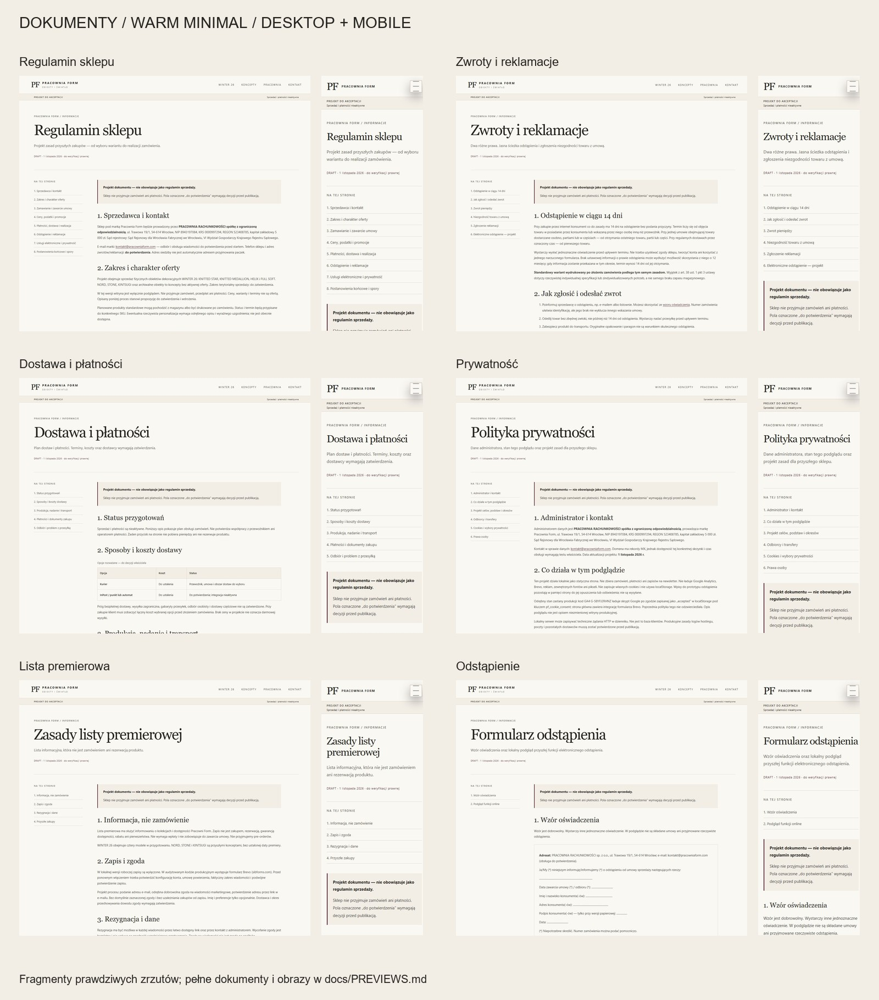

# Podglądy — R04 WINTER AFTER DARK

Aktualny materiał do decyzji: [R04_REVIEW.md](R04_REVIEW.md) — hero, karty i zestawy desktop/mobile, porównanie z aktualnym produkcyjnym homepage, kontrast i wyniki testów.

## Dokumenty i historia wcześniejszych wersji

Poniższe pełne zrzuty WINTER i plansza Warm Minimal dokumentują wcześniejszą, niezaakceptowaną paletę. Dokumenty prawne i lokalna strona główna nie były zmieniane w R04, więc ich zrzuty pozostają aktualne. Pełny zrzut R04 nie został zastąpiony starszą wersją; R04 ma osobne ujęcia sekcji w raporcie powyżej.

Rzeczywiste zrzuty lokalnego podglądu, bez publikowania strony. Desktop: viewport 1440×1000, mobile: 390×844. Pasek przewijania zajmuje 15 px, więc obrazy treści mają 1425 i 375 px szerokości. Pełne strony są dłuższe niż viewport. Dodatkowo sprawdzono układ 320 i 768 px; tabela polityki ma własne przewijanie poziome na małym ekranie.

| Strona | Pełny desktop | Pełny mobile |
| --- | --- | --- |
| WINTER 26 — historia Warm Minimal | [Desktop](previews/winter-26-desktop.jpg) | [Mobile](previews/winter-26-mobile.jpg) |
| Regulamin | [Desktop](previews/regulamin-sklepu-desktop.jpg) | [Mobile](previews/regulamin-sklepu-mobile.jpg) |
| Zwroty i reklamacje | [Desktop](previews/zwroty-i-reklamacje-desktop.jpg) | [Mobile](previews/zwroty-i-reklamacje-mobile.jpg) |
| Dostawa i płatności | [Desktop](previews/dostawa-i-platnosci-desktop.jpg) | [Mobile](previews/dostawa-i-platnosci-mobile.jpg) |
| Polityka prywatności | [Desktop](previews/polityka-prywatnosci-desktop.jpg) | [Mobile](previews/polityka-prywatnosci-mobile.jpg) |
| Lista premierowa | [Desktop](previews/zasady-premiery-desktop.jpg) | [Mobile](previews/zasady-premiery-mobile.jpg) |
| Formularz odstąpienia | [Desktop](previews/formularz-odstapienia-desktop.jpg) | [Mobile](previews/formularz-odstapienia-mobile.jpg) |
| Strona główna | [Desktop](previews/index-desktop.jpg) | [Mobile](previews/index-mobile.jpg) |

Porównanie: [zastany WINTER 26 — desktop](previews/before-winter-desktop.jpg). Interakcja: [demo odstąpienia — mobile](previews/withdrawal-demo-mobile.jpg). [Arkusz pełnych układów do kontroli wizualnej](previews/full-layout-review.jpg).

Plansze powstają z powyższych zdjęć przeglądarki przez `scripts/preview_board.py` (opcjonalna zależność Pillow); przedstawiają ich fragmenty i nie dodają elementów do UI. Hero jest neutralną kompozycją typograficzną HTML/CSS na papierowym tle, bez przedstawienia produktu. Poprzednie screenshoty są dostępne w historii Git; poniższe pliki przedstawiają wersję Warm Minimal.
