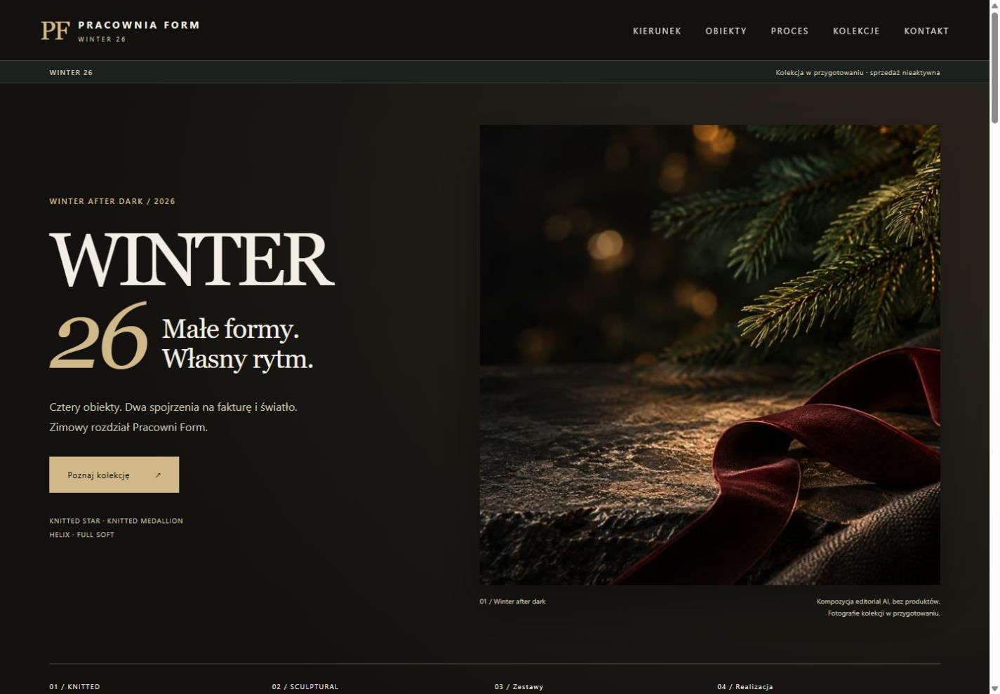
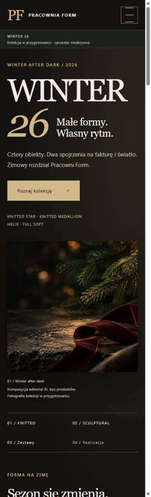

# WINTER 26 — R04: raport przygotowania do publikacji

Data: 1 listopada 2026. **Osobny PR do zatwierdzenia. Bez merge, publikacji, sprzedaży i uruchomienia płatności.**

## Baza i zakres

Gałąź `codex/winter26-r04-publication` powstała z aktualnego `main` przy `38e0bd9bc8296b70ac68d92753d63f447d70df3e`. Zatwierdzona oprawa R04 pochodzi z [PR #4](https://github.com/pracowniarachunkowosci-debug/form/pull/4), wersja `f6e218fe9cfa2772e805b9e62b8d86ae2dec91ba`. Nie scalano gałęzi roboczej ani jej izolowanego środowiska testowego.

Zmienione istniejące pliki to wyłącznie `winter-26.html` i `winter-26.css`. Dodano obrazy, dwa testy regresji, skrypt optymalizacji oraz dokumentację. Pozostałe **46 plików bazowych nie mają zmian w Git**, w tym strona główna, kontakt, formularze i ich adresy Brevo, `script.js`, `styles.css`, dokumenty publiczne, sitemap oraz CNAME.

Zachowano układ R04: ciemne hero, champagne, forest, jasne karty czterech modeli, KNITTED / SCULPTURAL, zestawy 2/4, realizacja i archiwum. Nie projektowano nowej palety. Hero nadal przedstawia neutralny editorial AI bez produktów i bombki. Zdjęcia, ceny, materiały, kolory, stany i terminy pozostają nieustalone. Nie dodano koszyka, zamawiania ani danych `Product`/`Offer` sugerujących aktywną ofertę.

Treści organizacyjne z draftu zastąpiono publicznym „w przygotowaniu”. Przywrócono istniejący nagłówek i stopkę z `main`, zachowując działające cele nawigacji oraz stare kotwice `#kierunek`, `#obiekty`, `#proces`. Dodano widoczne przejście do dotychczasowej listy premierowej `index.html#preorder`. Projekty prawne z PR #4 pozostają tam do odrębnego zatwierdzenia, nie zastępują obecnych dokumentów publicznych.

## Hero i wydajność

Źródło: zatwierdzony PNG 1536×1024, **2 128 258 B**. SHA-256: `216813d2d536ee70a7f7cda49b2b0f3c6c7632d4885d318b31d4e3292d5b5f66`. [Pochodzenie grafiki w PR #4](https://github.com/pracowniarachunkowosci-debug/form/blob/f6e218fe9cfa2772e805b9e62b8d86ae2dec91ba/docs/IMAGE_R04.md).

| Szerokość źródła | AVIF | WebP |
| --- | ---: | ---: |
| 480 px | 11 776 B | 19 912 B |
| 768 px | 24 798 B | 43 390 B |
| 1024 px | 39 536 B | 68 020 B |
| 1536 px | 69 746 B | 123 402 B |

Największy AVIF jest o **96,7%**, WebP o **94,2%** lżejszy od PNG. Każda przeglądarka wybiera jeden wariant; nie pobiera całego zestawu. Social/OG ma oddzielny JPEG 1200×800 (136 804 B). Źródłowego PNG nie dodano do nowej gałęzi.

`picture` preferuje AVIF i ma fallback WebP; `srcset` zawiera cztery szerokości. `sizes` uwzględnia dodatkowe 1,5× potrzebne do kwadratowego kadru `object-fit: cover` z obrazu 3:2, aby uniknąć zbyt małego źródła i rozmycia. Kadr i pozycja 68% pozostają z R04. W lokalnej przeglądarce: desktop 1440 wybrał **1024 AVIF (39,5 KB)**, pierwsza wizyta mobile 390 wybrała **768 AVIF (24,8 KB)**. Przy zmianie szerokości przeglądarka może wykorzystać większy obraz już obecny w cache.

Hero ma `fetchpriority="high"`, jawne wymiary i zarezerwowaną proporcję, bez lazy loading. Nie dodano biblioteki JS, zewnętrznych fontów ani podwójnego preloadu. Usunięto sztuczny preloader wyłącznie z WINTER 26; jego istniejący współdzielony skrypt pozostaje bez zmian. Wartości LCP/CLS w warunkach produkcyjnych nie były mierzone; nie deklaruję wyniku Lighthouse. Redukcja transferu i kontrola układu są zweryfikowane lokalnie.

Reprodukcja: `python scripts/optimize_hero.py /sciezka/winter-after-dark-r04.png` z Pillow 12.3.0 z obsługą AVIF/WebP. Manifest rozmiarów: [hero-optimization.json](hero-optimization.json).

## Formularze, cookies, analityka i SEO

- Formularz premierowy nadal wysyła `POST` do dotychczasowego hosta `ad958d5f.sibforms.com`. Pola e-mail i zgody są wymagane; przycisk oraz pola są aktywne. Opcjonalny wybór zainteresowania aktualizuje ukryte pole i komunikat. Kontakt i pozostałe formularze niezmienione.
- Skrypt `script.js`, inicjalizator GA `G-58YFJ2RHNZ`, klucz zapisu zgody i struktura banera cookies są zachowane. Domyślnie i po odmowie nie jest ładowany skrypt Google. Akceptacja ładuje go jednokrotnie, a decyzja pozostaje zapamiętana.
- Nie przeniesiono `noindex`, `nofollow`, `form-action 'none'`, blokady połączeń CSP, `review.css` ani demonstracyjnych handlerów formularzy z PR #4.
- Strona ma `index, follow`, właściwy canonical, opis czterech modeli, OG/Twitter z istniejącym nowym plikiem, `CollectionPage` i `BreadcrumbList`. Sitemap jest zachowana; adres WINTER 26 już w niej występuje.

## Weryfikacja i ograniczenia

| Kontrola | Wynik |
| --- | --- |
| `python scripts/check_publication.py` | PASS: 46 plików bazowych bez zmian, GA/cookies zachowane, odnośniki lokalne i kotwice poprawne, SEO i budżet obrazów |
| `node scripts/check_consent.cjs` | PASS: stan początkowy, odmowa, zapis odmowy, akceptacja, ponowna akceptacja, zapamiętana akceptacja; test bez sieci |
| HTTP lokalny | 14/14 odpowiedzi 200: strony/skrypt/CSS i wszystkie nowe obrazy |
| Przeglądarka | Szerokości 320, 390, 768, 1440: brak poziomego przepełnienia; hero dekoduje się poprawnie |
| Interakcje | Mobile menu otwiera się, Escape zamyka; szczegóły produktów rozwijają się; CTA prowadzi do listy premierowej |
| Zgody w przeglądarce | Nowa wizyta pokazuje baner, odmowa chowa go; brak skryptu GA przed zgodą i po odmowie |
| Konsola strony WINTER 26 | Brak odnotowanych ostrzeżeń i błędów |
| `git diff --check` | PASS |

Nie wysyłano próbnych zapisów do rzeczywistej listy Brevo ani zdarzeń do produkcyjnego GA. Dostarczenie wiadomości i pełny przebieg double opt-in wymagają osobnego testu kontrolowanym adresem przy odbiorze wdrożenia. Zachowanie istniejących plików i lokalne testy nie dowodzą dostępności zewnętrznych dostawców w chwili późniejszej publikacji. Test zgód uruchamia oryginalny kod w uproszczonym DOM; rzeczywiste pobranie Google po akceptacji świadomie nie było wykonywane.

Aktualna strona główna i opis jej listy nadal mówią o Nord/Stone/Kintsugi — to istniejąca treść `main`, zachowana zgodnie z wąskim zakresem. Zmianę komunikacji całej listy premierowej można zatwierdzić osobno. Ten PR nie przenosi roboczej przebudowy strony głównej z PR #4.

## Podglądy

Zrzuty pochodzą z lokalnego serwera, nie z publicznego deploymentu. Rozmiary docelowych viewportów: desktop 1440×1000, mobile 390×1280. Zapis obrazu może różnić się o pasek przewijania i skalowanie przeglądarki; są to kadry viewportu, nie pełna strona.

- [Karty desktop](previews/winter-r04-products-desktop.jpg)
- [Karty mobile](previews/winter-r04-products-mobile.jpg)
- [Zestawy desktop](previews/winter-r04-sets-desktop.jpg)
- [Pierwsza wizyta i cookies mobile](previews/winter-r04-cookie-mobile.jpg)

## Odbiór i późniejsze wdrożenie

PR pozostaje draftem. Przed przyszłym merge sprawdzić, czy `main` nie otrzymał nowych zmian, ponowić test regresji i zatwierdzić hosting/publikację. Obecna konfiguracja Pages korzysta z `main` i katalogu `/`; sam push tej gałęzi nie publikuje strony. Nie zmieniono konfiguracji wdrażania ani domeny. Przy zatwierdzonym późniejszym wdrożeniu plan powrotu to revert tego PR, bez modyfikacji listy, danych zapisów i zgód.

Osobny dokument do decyzji: [propozycja architektury sklepu](STORE_ARCHITECTURE.md). Zgoda na wygląd R04 nie jest zgodą na uruchomienie checkoutu ani płatności.
