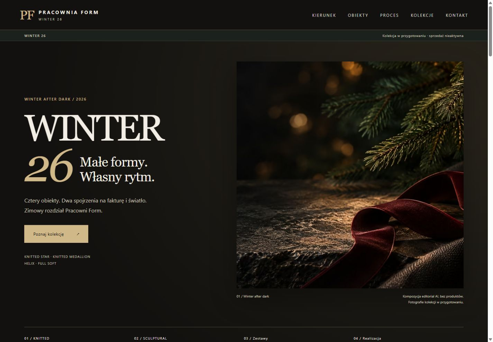
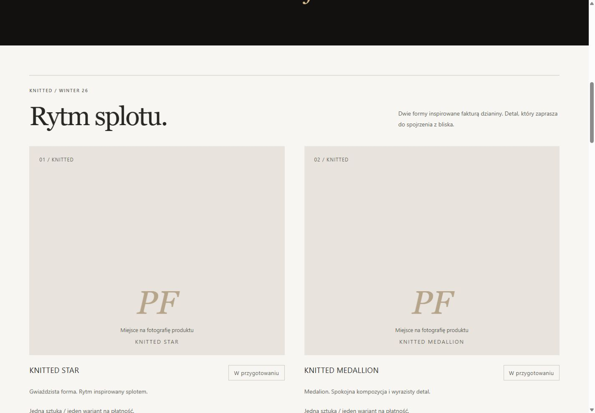
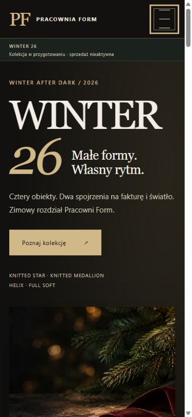
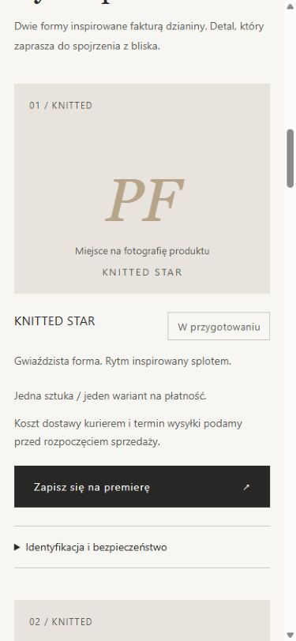
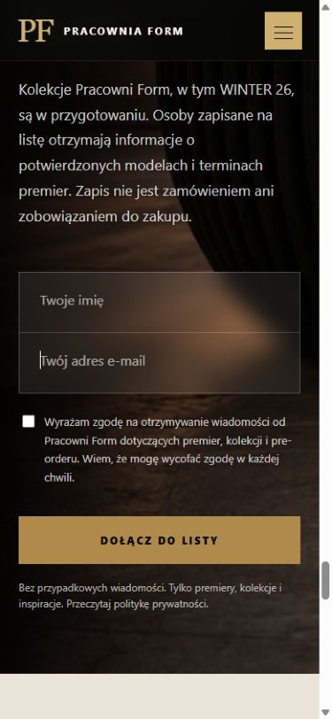

# Raport przygotowania publikacji — hybrydowy R04 / LH Orange

**Nowsza iteracja hero:** [wizualizacja otwartej bombki, źródło i porównanie desktop/mobile](HERO_CONCEPT_PREVIEW.md). Jest już podłączona lokalnie. Opis i podglądy editorialu bez produktu poniżej dokumentują poprzedni etap. Po tej zmianie historyczna paczka e3eba15 nie jest bieżącym kandydatem do wdrożenia.

3 listopada 2026. **Draft do przeglądu, bez wdrożenia.** Realizacja fazy A z [PR #10](https://github.com/pracowniarachunkowosci-debug/form/pull/10#issuecomment-6606701517). [Audyt DNS/LH, migracja, rollback i warunki wdrożenia](LH_ORANGE_MIGRATION.md).

Aktualizacja po obu recenzjach PR #11: [odpowiedź na uwagi i nowe testy](PR11_REVIEW_RESPONSE.md), [warunki GO/NO-GO](RELEASE_READINESS.md), [plan kontrolowanego testu Brevo](BREVO_ACCEPTANCE_PLAN.md), [oczekiwanie na zdjęcia](PRODUCT_PHOTO_HANDOFF.md). To dokumenty bieżącego stanu; wcześniejszy audyt panelu pozostaje odczytem historycznym.

## Zakres zmiany

- Osobna gałąź `codex/lh-orange-hybrid-publication` z aktualnego `main` (`38e0bd9`). Inne gałęzie PR pozostają bez zmian.
- Zatwierdzona hybryda: ciemny hero/header/intro R04, neutralne karty na porcelain/stone, ciemne CTA, ciemne zestawy i stopka. Bez nowych wariantów projektu.
- Integracja produkcyjnego HTML i wspólnego `script.js`: nie przeniesiono testowego `noindex`, CSP blokującego formularze, pustego identyfikatora GA ani mocków z `previews/lean-pilot`.
- Warstwa R04 i zoptymalizowane grafiki pochodzą z przygotowania PR #5 (`f97fcd6`); zatwierdzone style kart i neutralna paleta z PR #10 (`1ade238`). Te PR nie zostały zmodyfikowane ani scalone. Kod połączono na nowej gałęzi na bazie `main`.
- Hero to podpisany editorial AI bez produktów. Cztery karty mają jawne miejsca na fotografie, jeden status na kartę, CTA do rzeczywistej listy, informację o dostawie przed CTA i rozwijane informacje o identyfikacji/bezpieczeństwie. Bez cen, koszyka, wyboru wariantu, checkoutu i płatności.
- `index.html`: doprecyzowanie zapowiedzi WINTER i braku zobowiązania zakupowego; link do prywatności przy formularzu. **Cały element `<form>` Brevo jest identyczny jak w main po normalizacji końców linii.** Endpoint, pola, wymagane zgody i zewnętrzny skrypt nie zostały zastąpione.
- Naprawione nieistniejące kotwice `#manifest`/`#wykonczenia` → istniejące `#pracownia`/`#materialy`; mobilne menu kontaktu, prywatności i zasad premiery podłączone do istniejącego JS. Usunięto pozorny odnośnik Instagram „Wkrótce” i odwołania do nieistniejących faviconów; zachowano SVG.
- W prywatności poprawiono kontakt `.com`, fakty o już używanym Brevo i analityce po zgodzie oraz dane administratora wskazanego przez właściciela (ALEO, porównane z API KRS). Te same dane identyfikują sprzedawcę w WINTER. Nie dodano rachunku bankowego ani danych osób z zarządu.
- Na wszystkich dziesięciu stronach dodano dostęp do ustawień cookies, ponowny wybór i wycofanie zgody. Zmiany wspólnego JS i CSS dotyczą tego interfejsu; pozostały JS, `robots.txt`, `sitemap.xml` i inicjalizacja GA pozostają zgodne z bazą. Nagłówek i główna treść WINTER pozostają zgodne z zatwierdzonym stanem `e054e60`.
- Zasady premiery opisują teraz WINTER 26 i przygotowywaną przedsprzedaż bez aktywnej sprzedaży. Polityka prywatności ma datę projektu 03.11.2026, odbiorców, podstawy, kryteria retencji i transfery z jawnymi kwestiami do potwierdzenia. Data projektu nie jest datą zatwierdzenia. Stopki wskazują 2026.

## Wyniki weryfikacji

| Kontrola | Wynik / granice |
|---|---|
| `python scripts/check_publication.py` | PASS: 10 HTML, 271 lokalnych odnośników/zasobów, kotwice, unikalne ID, jeden H1, alt, JSON-LD, zachowanie formularza i projektu WINTER, kontrolki cookies na każdej stronie, brak blokad testowych i płatności WINTER |
| `node scripts/check_consent.cjs` | PASS: brak decyzji, odmowa, akceptacja, zapamiętane wybory, wycofanie po akceptacji, odświeżenie i ponowna akceptacja, czyszczenie cookies GA, synchronizacja odmowy między kartami, blokada storage i brak GA na stronach bez inicjalizacji; VM bez sieci |
| HTTP lokalnego wydania | Poprzednia kontrola: wszystkie 55 plików odpowiadały 200. Bieżący pełny odczyt HTTP przerwał się na niezmienionym `assets/hero-form.webp`: status 200, niepełny transfer, timeout/reset także po ponowieniu. Przyczyny lokalnego serwera/transportu nie ustalono; nie oznaczamy tej kontroli jako PASS. Bajty pliku w ZIP są zgodne z manifestem. Test pełnego transferu po zatwierdzonym uploadzie LH pozostaje bramką odbioru |
| Desktop 1440×1000 | Hero AVIF ładuje się, przejście do kolekcji działa, neutralne karty i kontrastowe CTA; podglądy niżej |
| Mobile 390×844 i 320×740 | Bez poziomego overflow; jedna kolumna kart; czytelne CTA. Test WINTER menu open/close/Escape; Enter otwiera i zamyka szczegóły |
| Cookies w przeglądarce | PASS: otwarcie ze stopki i polityki, Escape i powrót fokusu, odmowa→odświeżenie bez skryptu Google, mobile 390×844 i 320×568 bez poziomego overflow. Na niskim ekranie panel przewija się i przycisk zamknięcia działa. Akceptację testowano w VM, bez wysyłania analityki do produkcyjnej usługi |
| Menu kontakt/prywatność | Poprzedni test PASS: `aria-expanded` false→true→false po Escape. Nową treść zasad premiery odczytano również w przeglądarce mobilnej |
| Newsletter | CTA karty prowadzi do `index.html#preorder`; wymagane e-mail i zgoda, nieprawidłowy e-mail rozpoznawany, wybór zainteresowania zapisuje ukryte pole. Test bez POST; publiczny endpoint Brevo dostępny. Double opt-in i dostarczenie wymagają kontrolowanego testu właściciela |
| SEO | WINTER ma canonical domeny docelowej, index/follow, OG/Twitter, CollectionPage/BreadcrumbList, bez fikcyjnych Product/Offer. Istniejący noindex stron potwierdzenia zapisu pozostaje celowy |
| Dostępność | Semantyka/alt/H1/ID sprawdzone automatycznie; menu i details klawiaturą. Tekst charcoal/porcelain 13,84:1; muted/stone 5,39:1; muted/porcelain 6,31:1. PF w placeholderze jest dekoracyjne i aria-hidden. Nie wykonano pełnego audytu WCAG ani testów czytnikiem ekranu |
| `git -c core.whitespace=cr-at-eol diff --check` | PASS; repozytorium zawiera starsze pliki CRLF |

Testy wykonane lokalnie w Chrome. Nie symulowano słabej sieci ani nie mierzono terenowych Core Web Vitals; brak deklaracji wyniku Lighthouse. Wydajność hero potwierdzono przez dobór źródła AVIF i rozmiary plików.

## Hero i paczka

| Szerokość | AVIF, bajty | WebP, bajty |
|---|---:|---:|
| 480 | 11 776 | 19 912 |
| 768 | 24 798 | 43 390 |
| 1024 | 39 536 | 68 020 |
| 1536 | 69 746 | 123 402 |

Social JPG 1200×800: 136 804 bajty. `<picture>` preferuje AVIF, ma WebP fallback, `srcset`, `sizes`, wymiary i `fetchpriority="high"`; bez lazy loading hero. Rozmiar 1024 AVIF został zaobserwowany przy desktop 1440. Jedno źródło obrazu, bez generowania nowej kompozycji.

`python scripts/build_release.py` tworzy tylko lokalne `.artifacts/pracownia-form-lh.zip`, manifest ścieżek/rozmiarów/SHA-256 i `release.json` z commitem, statusem drzewa oraz hashem ZIP. Archiwum ma stałe metadane i kontrolę CRC oraz każdego pliku względem manifestu. Około **7,6 MB nieskompresowanych danych**, daleko poniżej przydziału WWW 1000 MB. Zawiera również zasoby pozostałych kolekcji. `.artifacts` nie trafia do Git; brak automatyzacji uploadu, DNS lub deploy. Konkretną paczkę identyfikuje [metryka kandydata](RELEASE_CANDIDATE.md). Każda zmiana plików strony wymaga nowego wydania i akceptacji.

## Podglądy

Desktop — hero:

Desktop — przejście do neutralnych kart:

Mobile — hero oraz karta:

Formularz — lokalny test bez wysyłki:

## Pozostałe warunki

To kandydat do publikacji **zapowiedzi**, nie gotowy sklep. Obowiązuje NO-GO do zamknięcia warunków w RELEASE_READINESS: akceptacja treści i ewentualnego przejściowego editorialu, rzeczywiste ustawienia prywatności, kontrolowany test Brevo i kontaktu, pełny eksport DNS/DKIM, zewnętrzna poczta LH, SSL i osobna zgoda na fazę B. Zdjęcia produktów czekają na dostarczenie; nie zastąpiono ich fikcyjnymi obiektami. Dane produktów, SKU, terminy, dokumenty sprzedaży i GPSR wymagają akceptacji przed włączeniem zakupów. Test HTML nie potwierdza kompletności prawnej dokumentów.

Nie wykonano merge, zakupów, zmian hostingu/DNS/poczty, uploadu, publikacji ani aktywacji płatności. Brak sekretów i zrzutów prywatnego panelu w repozytorium.
