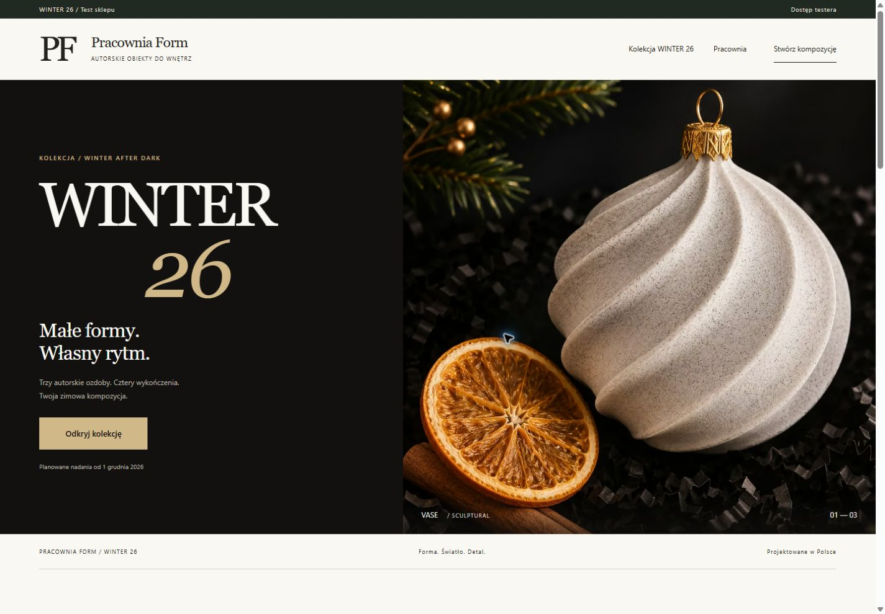
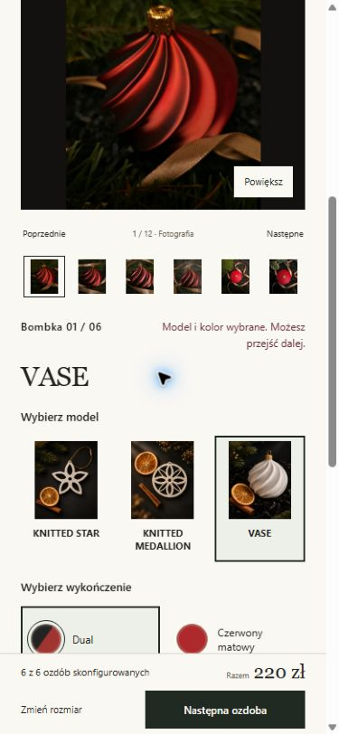
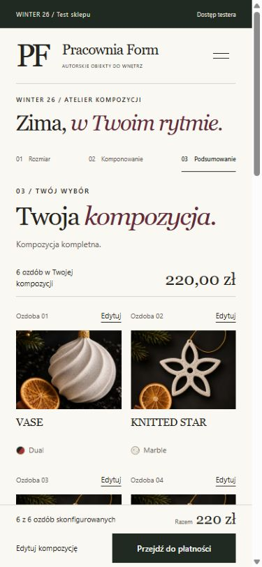

# R01.5 — deployed to pf26 Sandbox

Acceptance date: 2026-11-15. Target: **https://pf26.uber.space**.
The owner-authorized visual integration is deployed and passed real HTTPS and
Chrome checks. Physical-phone acceptance by the owner remains the next step.
PR #28 remains a draft; no merge or production deployment.

## Release and preservation

- Deployed source commit: `18dee14ef2c5eab3006d8acf4b11a93a6c0aabef`.
- ZIP SHA-256: `b799986fa9da9bba42e4275ddbb18812ae38f9dc2d57bd8df7d19ab144a32807`.
- Manifest SHA-256: `bd1c94d4915a657f2910e0b3e7702cc9689307fee4a0666d9fc4e026c7a152c3`.
- 285 deployed files: 8 existing presentation files replaced, 161 assets added,
  no existing files deleted. All 285 served/retrieved file hashes match.
- PHP 8.5 retained. Existing backend, commercial JSON, legal pages, security
  overlay, private configuration, Stripe and InPost configuration are preserved.
- Every SQLite table and the private configuration match the pre-deployment
  snapshot after deployment **and again after browser acceptance**. The actual
  baseline contains **3 paid Sandbox orders and 1 released order**; all remain.
  No new order, reservation, payment or shipment was created by this integration.

The repository portfolio index is unchanged. Only the staging release overlays
`index.html` with the accepted WINTER 26 landing page. See the exact
[release delta](r015-20261115/release.json) and [manifest](r015-20261115/manifest.json).

## Real acceptance

| Check | Result |
|---|---|
| Anonymous page, asset, checkout, webhook GET, alternative API path | 401 |
| Wrong Basic Auth password | 401 |
| noindex, noarchive and no-store | Independently verified on 401 and 200 |
| Exact unsigned webhook POST | 400, SIGNATURE |
| Private configuration/database paths | Denied |
| Authenticated pages and new assets | 200 and expected hashes |
| Tester login using existing credentials | Passed |
| Status, stock and TEST01M / TEST02M | Real API checks passed |
| Invalid checkout payload | Rejected, no order created |
| Return and cancel pages | Existing PHP behavior with R01.5 presentation |
| Source lint and existing checkout suites | Passed; details in integration report |

Actual Chrome checks on pf26 covered all size choices 1/2/4/6/8, a complete six-item
composition, repeated variants, specific missing-model and missing-color guidance,
immediate progress, direct item editing and model changes clearing the finish.
Courier and both synthetic pickup points were verified. After each point was
validated by the real API, the single payment CTA became available.

Product, configurator, summary and landing layouts were measured at
320/360/390/430/1280/1440 px, with no horizontal document overflow or broken loaded
images. Composer and summary expose one primary stage CTA. Visual checks include
mobile/desktop, the sticky bar, accessible footer, keyboard thumbnail navigation,
2x zoom, Escape dismissal, mobile menu and return to the collection/configurator.
These are browser viewport tests, not a claim of testing a physical phone.

The existing backend's earlier successful card/BLIK Sandbox payments remain the
payment evidence. A local isolated checkout fixture verified one request for one
click; no extra positive checkout or payment was submitted on staging during this
visual acceptance. Unavailable-stock and idempotency cases remain covered by the
existing isolated behavioral suites.

## Photography

Lifestyle remains the first tab: 12 VASE, 5 STAR and 3 MEDALLION arrangements.
Confirmed product frames: VASE Dual 1 and White 1; STAR Marble 2; MEDALLION Marble 1.
Other finishes show an honest missing-photo state. Only the exact VASE Dual main
photo is OWNER APPROVED. White/Marble corrections, quality rejection and archival
exclusion follow the [decision record](r015-20261115/photo-decisions.json).
Roles and original bytes/hashes are unchanged; no sales-catalog photoAsset changed.

## Rollback

The pre-deployment public release was copied locally and to the same account,
with every backup file hash verified before replacement. Server copy:
`/var/www/virtual/pf26/winter26/backup/r015-20261115-004319`.
The owner-local integration session supports `rollback` using its unique-ID
command queue. It verifies the deployed files, restores only the original public
release, removes only this release's exact added files, and never restores or
resets SQLite. The SSH key must be locally unlocked if the session has closed.

One earlier attempt was automatically restored after the webhook test expected
the wrong JSON field. The existing API correctly returns `error: SIGNATURE`;
only the test was corrected. The final deployment and repeated verification pass
all gates. Earlier manifest line-ending and PHP-block comparison issues stopped
before writes. No security requirement was relaxed.

## Evidence and owner entry

- [Deployment checks](r015-20261115/deployment.json)
- [Final post-browser verification](r015-20261115/final-verification.json)
- [Browser checks](r015-20261115/browser-checks.json)
- [Integration scope and pre-deployment tests](R015-STAGING-INTEGRATION.md)

Open **https://pf26.uber.space** and use the existing Basic Auth credentials.
Before composing, open **Dostęp testera** and use the existing tester token from
the owner's local secure store/password manager. Credentials have not changed.
Choose a size, models and finishes, review each ornament and select courier or
TEST01M/TEST02M. The final action leads to the existing Stripe Sandbox flow.

