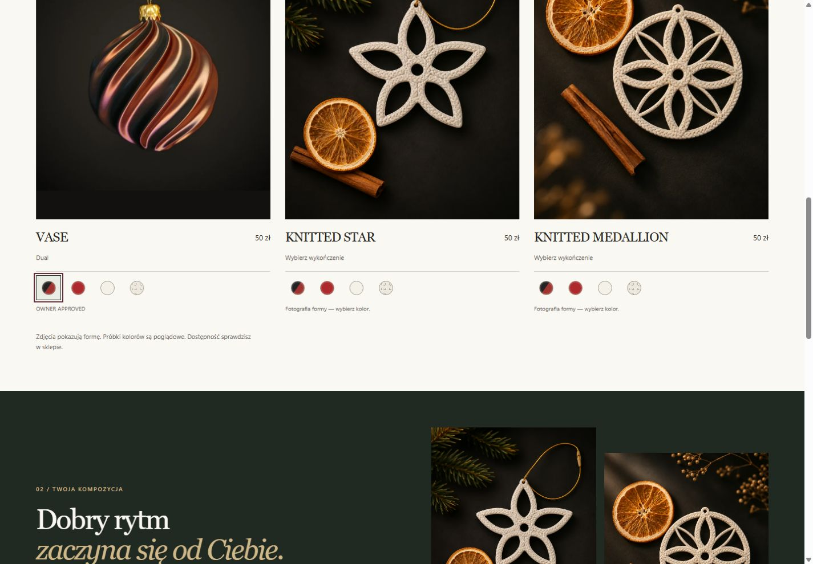
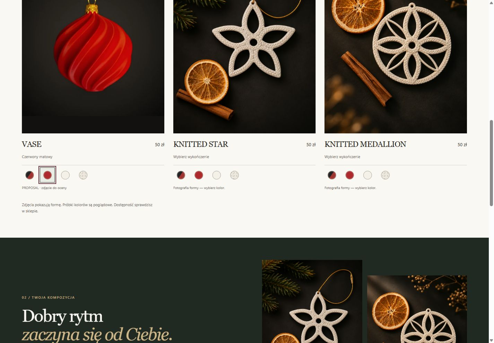
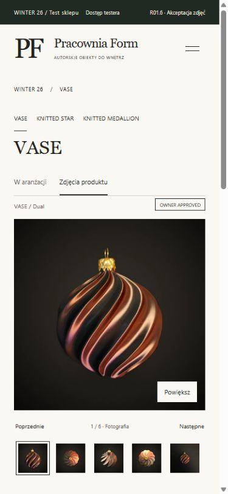
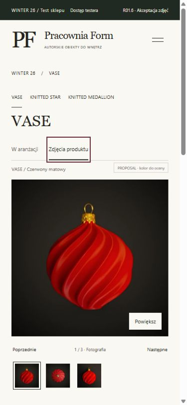
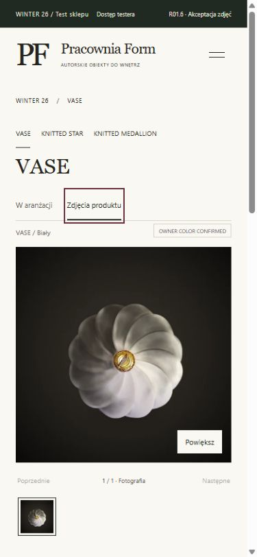
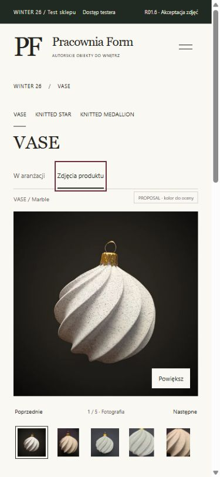
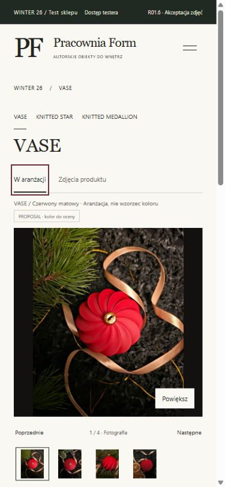
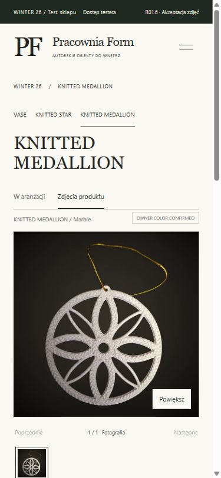

# R01.6 — odbiór funkcjonalnego przełączania fotografii

15 listopada 2026. Wdrożenie wyłącznie na chroniony staging
[pf26.uber.space](https://pf26.uber.space).
[Plansza wszystkich 12 wariantów](https://pf26.uber.space/winter-foto-r016.html).
Dotychczasowy Basic Auth i dostęp testera pozostają bez zmian. PR #28 pozostaje
draftem; nie wykonano merge ani publikacji produkcyjnej.

Poniższe liczby i zrzuty dokumentują pierwotne wydanie R01.6.
[Późniejsza korekta właściciela: STAR/MEDALLION Marble i odrzucenie rozmytego kadru](R016-PHOTO-CORRECTION.md)
aktualizuje rejestr i macierz; nie zmienia historycznego dowodu tego wdrożenia.

## Co działa

Próbki na kartach są rzeczywistymi przyciskami wyboru typu radio, dostępnymi
klawiaturą. Zmieniają fotografię istniejącej roli `main` albo pokazują brak zdjęcia
głównego. Link zachowuje wybrany kolor. Zdjęcia gallery/detail/lifestyle nie są
automatycznie awansowane do main.

Obie zakładki galerii filtrują dokładną parę model–kolor. Zmiana wykończenia
aktualizuje fotografię, miniatury, podpis i powiększenie. Brak materiału usuwa
poprzednią fotografię i udostępnia przejście do drugiej zakładki. Aranżacje nadal
są inspiracją, a nie wzorcem koloru. Propozycje są jawnie opisane jako
`PROPOSAL · kolor do oceny`; ich wyświetlanie jest ograniczone do chronionego
pf26 i lokalnego podglądu. Domyślny selektor poza tym trybem wymaga potwierdzenia.

## Pełna macierz materiałów

Liczby oznaczają istniejące rekordy eksportów, nie zawsze odrębne ujęcia — część
detali była wcześniej przygotowanymi kadrami. Nie generowano nowych zdjęć i nie
powtarzano audytu całej sesji.

| Model | Dual | Czerwony matowy | Biały | Marble |
|---|---|---|---|---|
| VASE | 1 OWNER APPROVED + 9 propozycji | 7 propozycji | 1 COLOR CONFIRMED + 2 kandydatury tylko do oceny | 9 propozycji |
| KNITTED STAR | **Brak materiału** | 4 propozycje | 4 propozycje; bez main | 2 COLOR CONFIRMED |
| KNITTED MEDALLION | **Brak materiału** | **Brak materiału** | 3 propozycje lifestyle; bez packshotu | 1 COLOR CONFIRMED |

Jedynie dokładna główna fotografia VASE/Dual ma status OWNER APPROVED.
Pozostałe cztery potwierdzone fotografie zachowują OWNER COLOR CONFIRMED.
White VASE ma potwierdzone dodatkowe ujęcie z góry, ale nie nową zatwierdzoną
fotografię główną. WEB006 i WEB022 pozostają wyłącznie na planszy właściciela:
wcześniejszy audyt wymaga potwierdzenia geometrii/modelu. STAR/White ma dodatkowe
ujęcie i aranżacje, MEDALLION/White wyłącznie aranżacje. Żadna aranżacja nie
otrzymała tu nowego zatwierdzenia właściciela.

STAR WEB018 nadal jest REJECTED_QUALITY; MEDALLION WEB016 pozostaje usunięte
z proponowanej galerii i zachowane w archiwum. Cappuccino pozostaje nieaktywne.
Oryginały, role oraz ich SHA-256 nie zostały zmienione.

[Szczegółowa macierz i role](r016/matrix.json),
[pliki źródłowe i SHA-256](r016/media-provenance.json),
[zachowane odrzucenia](r016/excluded.json).

## Panel decyzji

Jedna plansza 3 × 4 zawiera zdjęcia, miniatury, źródłową nazwę pliku, model,
kolor, rolę, status oraz zatwierdzenie/odrzucenie. Na telefonie układa się w jedną
kolumnę. Powiększenie pozwala ocenić konkretny kadr.

Nowe decyzje są zapisywane **lokalnie w tej przeglądarce**. Przycisk eksportu
zapisuje je do JSON z dokładnym zdjęciem, rolą i hashem. Dopiero osobny import do
trwałego rejestru może zmienić zatwierdzony materiał; samo kliknięcie nie publikuje
fotografii ani nie aktualizuje sklepu. Test przycisków wykonano lokalnie w trybie
`?test=1`, bez zapisania fikcyjnych decyzji właściciela.

## Dowody testów

- Test selektorów: wszystkie 12 par, tryb potwierdzony i propozycji, brak
  mieszania kolorów, zachowanie ról, odrzuceń i dokładnego OWNER APPROVED — PASS.
- Istniejące testy konfiguratora i kompozycji — PASS. PHP lint 12 plików API
  i kontrola składni nowych modułów — PASS.
- Lokalna przeglądarka: 12 kart i 48 stanów galerii (12 par × 2 zakładki ×
  desktop/mobile), przyciski planszy, miniatury i zoom — PASS.
- **Rzeczywiste HTTPS:** 24 przejścia z kart do produktu (12 par przy 1440 px
  i 12 przy 390 px), z zachowaniem koloru — PASS.
- **Rzeczywiste HTTPS:** 48 stanów galerii (12 par × 2 zakładki × desktop/mobile).
  Zmieniano kolory oraz modele, porównywano właściwe zdjęcie i pełną listę
  miniatur, sprawdzano usunięcie fotografii przy braku materiału — PASS.
- Rzeczywisty VASE: Dual → czerwony → White → Marble, osobno zmiana aranżacji;
  zapisane obrazy pokazują różne fotografie, nie tylko zaznaczenie próbki.
  Powiększenie, kolejne zdjęcie i zamknięcie Escape — PASS.
- Responsywna plansza: 320/360/390/430/1280/1440 px, 12 komórek i brak poziomego
  przepełnienia. Galeria również sprawdzona przy tych szerokościach.
- Są to testy przeglądarki z wymiarami viewportu, nie odbiór na fizycznym telefonie.

Pod koniec połączenie automatyzacji przeglądarki przestało odpowiadać podczas
zapisu końcowej planszy. Zapisane wcześniej testy wszystkich 12 par i poniższe
zrzuty pozostają dowodami; końcowego zrzutu planszy z HTTPS nie udało się zapisać.
Nie przedstawiamy tego brakującego zrzutu jako wykonanego testu wizualnego.

[Lokalne wyniki](r016/browser-local.json),
[podsumowanie obserwacji HTTPS](r016/browser-https.json).

### Karty: Dual i czerwony

### Galerie na mobile

| VASE Dual | VASE czerwony | VASE White | VASE Marble |
|---|---|---|---|
|  |  |  |  |

| Czerwona aranżacja z oznaczeniem propozycji | MEDALLION Marble, potwierdzony kolor |
|---|---|
|  |  |

## Pakiet i ochrona danych

Źródło wydania: `993897d3af2a12e180f3caeff3be54280f5a5c34`, czysty checkout.
Świeży pakiet zawiera **382 pliki**, w tym **6 zmienionych istniejących HTML**
i **97 dodanych plików**. Niczego nie usunięto. Cały dotychczasowy backend,
kontroler checkoutu, dane handlowe, dokumenty prawne, zabezpieczenia i zasoby
R01.5 zachowały dokładne hashe.

- ZIP SHA-256: `203f7adda85c873eabff6e3a32793e1f18c2649812ef58df7679c1dfad485768`
- Manifest SHA-256: `b0b872737ea303d693e7340f6b7b0544e7441485070caba17f36402b9e2f640a`
- [Manifest](r016/manifest.json), [wydanie i delta](r016/release.json).

Wdrożenie i ponowna weryfikacja po testach potwierdzają wszystkie 382 hashe.
Basic Auth obejmuje również planszę. Anonimowa strona, asset, checkout, GET
webhooka i alternatywne API zwracają 401. Niezależnie sprawdzono noindex,
noarchive i no-store dla 401 i 200. Błędne hasło jest odrzucane, prywatne ścieżki
są niedostępne; dokładny POST webhooka bez podpisu zwraca 400 SIGNATURE.
Test logowania testera, statusu i stanów, obu punktów MOCK, błędnego checkoutu
oraz rzeczywistych tras powrotu/anulowania przeszedł.

Wszystkie tabele SQLite oraz prywatna konfiguracja odpowiadają odczytowi przed
wdrożeniem. Zachowano **3 opłacone zamówienia Sandbox i 1 zwolnione zamówienie**
z aktualnego zastanego stanu. Nie tworzono nowych płatności, zamówień, rezerwacji
ani przesyłek. Nie zmieniono cen, SKU, stanów, Stripe, InPost ani PHP 8.5.

[Dowód wdrożenia](r016/deploy.json), [końcowy odczyt](r016/verify-final.json).
Pole `deployed: false` w końcowym odczycie oznacza operację wyłącznie `verify`;
jej wynik to `verified: true`.

## Rollback i granica odbioru

Zweryfikowana pełna kopia 285 plików R01.5:
`/var/www/virtual/pf26/winter26/backup/r016-20261115-012642`.
Zachowano również lokalny poprzedni pakiet i manifest. Istniejące narzędzie
rollbacku odtwarza publiczne pliki bez zastępowania bazy ani konfiguracji.

Mechanizm wariantów jest wdrożony i sprawdzony. **Nie oznacza to kompletnej,
zatwierdzonej sesji wszystkich 12 wariantów ani gotowości produkcyjnej.**
Odbiór właściciela obejmuje istniejące propozycje, wymienione braki i własny
telefon. Po tej wersji nie wykonujemy kolejnych zmian bez decyzji właściciela.
