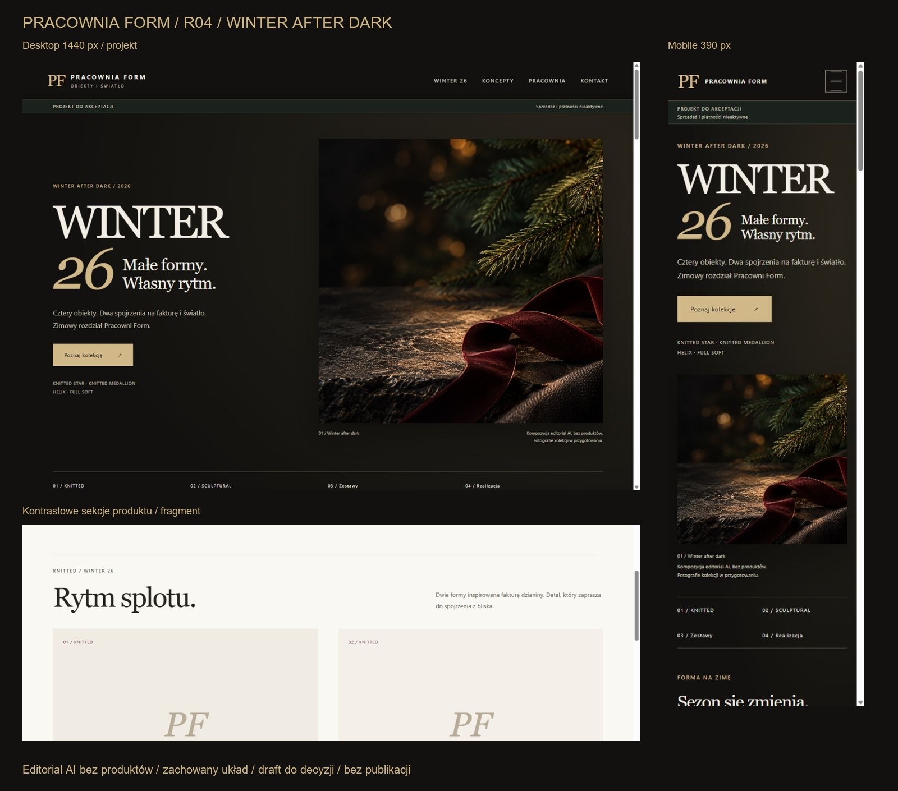
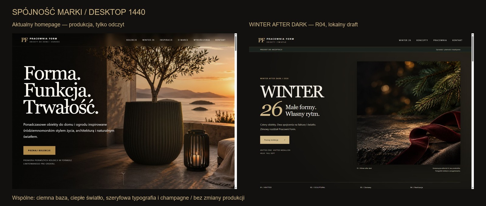
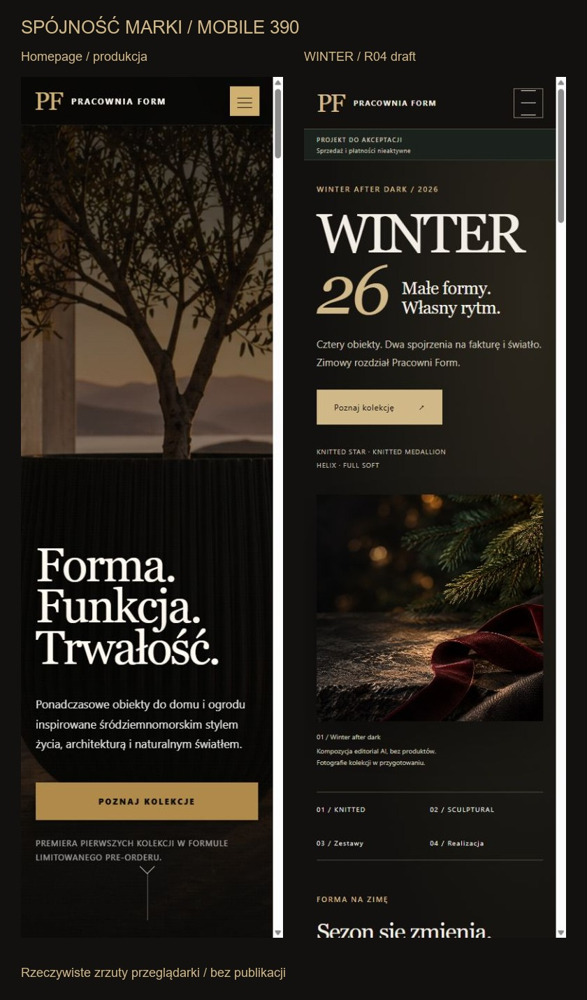

# R04 — WINTER AFTER DARK / do decyzji

Realizacja [feedbacku właściciela](https://github.com/pracowniarachunkowosci-debug/form/pull/4#issuecomment-6563747550). Warm Minimal nie został zaakceptowany; nie traktujemy wcześniejszej pochwały układu jako akceptacji palety ani publikacji.

## Zmiana art direction

Zachowano siatki desktop/mobile, fonty, hierarchię, cztery modele KNITTED/SCULPTURAL, zestawy 2/4, dane i treści dokumentów. Zmiana obejmuje wyłącznie WINTER 26 i materiały review. CSS nowej palety jest ograniczony do `.winter-page` / arkusza WINTER. W tej rewizji nie zmieniono `index.html`, `review.css`, skryptów integracji ani dokumentów prawnych.

Hero i otwarcie narracyjne mają głęboką czerń/antracyt; sekcja zestawów — dark forest; karty produktów pozostają jasne ivory. Champagne wraca w CTA, numeracji i wybranych akcentach. Burgund jest subtelnym detalem wstążki i kart. Monogram PF i istniejący układ typograficzny nie są zastępowane nowym znakiem.

Hero to wygenerowany editorial z igliwiem, kamieniem, wstążką i światłem. Nie przedstawia produktów; nie ma bombek, nowych modeli ani renderów udających ofertę. Podpis na stronie jasno wskazuje editorial AI i przygotowywanie zdjęć kolekcji. [Asset, narzędzie i finalny prompt](IMAGE_R04.md). Zatwierdzone zdjęcia rzeczywistych modeli mogą zastąpić kompozycję później.

## Podglądy i porównanie

| Widok R04 | Desktop 1440 | Mobile 390 |
| --- | --- | --- |
| Hero | [Desktop](previews/winter-r04-hero-desktop.jpg) | [Mobile](previews/winter-r04-hero-mobile.jpg) |
| Karty produktów | [Desktop](previews/winter-r04-products-desktop.jpg) | [Mobile](previews/winter-r04-products-mobile.jpg) |
| Zestawy | [Desktop](previews/winter-r04-sets-desktop.jpg) | [Mobile](previews/winter-r04-sets-mobile.jpg) |

Referencja to zrzuty aktualnej `https://pracowniaform.com/`, wykonane tylko w trybie odczytu; nie lokalna, zmodyfikowana strona główna z draftu. Teksty/oferta widoczne na referencji nie są tu zatwierdzane. Nie wysłano formularza ani nie przyjęto zgód analitycznych. Screenshoty mają szerokość treści 1425/375 px po odjęciu paska przewijania. Mobile wykonano w wysokim viewporcie 390×1280, aby pokazać kompozycję hero pod tekstem.

R04 dokumentują rzeczywiste viewporty kluczowych sekcji. Próba pojedynczego pełnego zrzutu strony zwracała błąd narzędzia przeglądarki, więc nie przedstawiamy wcześniejszych pełnych zrzutów Warm Minimal jako R04. Układ poza widocznym viewportem sprawdzono przez nawigację do sekcji i kontrolę DOM.

## Czytelność i sprawdzenie

Kolory odczytano z obliczonych stylów w przeglądarce. Kontrast liczony według względnej luminancji sRGB; dla tekstu na gradiencie przyjęto jego najjaśniejszy kolor bazowy `#29251c`. Tekst hero znajduje się obok fotografii, a nie na zmiennych detalach zdjęcia.

| Para | Współczynnik |
| --- | --- |
| Tytuł ivory / najjaśniejsze tło hero | 13,21:1 |
| Tekst i podpis / najjaśniejsze tło hero | 9,00:1 |
| Champagne / najjaśniejsze tło hero | 7,94:1 |
| Tekst CTA / champagne | 9,82:1 |
| Tekst zestawów / dark forest | 8,74:1 |

Kontrola 320, 390, 768 i 1440 px: brak poziomego przepełnienia strony, jeden H1, cztery właściwe modele, brak uszkodzonych obrazów i aktywnych formularzy. [Wyniki R04](r04-browser-checks.json). Menu mobile ma jasny tekst na ciemnym tle; otwarcie, Escape i przejścia do kart/zestawów sprawdzone. Konsola bez błędów/ostrzeżeń w końcowym przebiegu. To kontrola podstawowa, nie pełny audyt WCAG.

`python scripts/check.py --http`: PASS — 15 stron, 458 odniesień, 42 lokalne adresy HTTP 200. Nowy asset PNG ma ok. 2,13 MB; przed publicznym wydaniem potrzebny jest osobny budżet wydajności i zoptymalizowane warianty responsywne (docelowe zdjęcia mogą się zmienić).

## Rozdzielenie projektu od publikacji

- **PR #4 pozostaje wyłącznie projektem.** Nie należy merge'ować go do produkcji; noindex, pusty sitemap oraz wyłączone integracje to izolacja review, a nie decyzja o usunięciu działających zapisów.
- **Przyszły PR publikacyjny** powinien powstać z aktualnego `main`, przenosząc tylko zatwierdzone fragmenty WINTER/stopki/polityki. Zachować działające zapisy, consent i SEO; ponownie sprawdzić formularze i sieć. Nie przenosić automatycznie CSP/JS/noindex/sitemap z draftu. Obecnie brak zatwierdzonego finalnego kierunku, więc nie utworzono PR-u sugerującego gotowość do publikacji.
- **Przyszły sklep / osobny etap techniczny:** wybór backendu, koszyka, operatora płatności i integracji InPost; rezerwacje SKU i zdolności produkcji, zwalnianie rezerwacji, statusy magazyn/druk, obsługa powtórzonych zdarzeń, potwierdzenia i zwroty. JSON jest jedynie szkieletem danych. Nie wybrano ani nie aktywowano dostawców.
- **Dokumenty finalne:** wymagają usunięcia opisów wewnętrznego podglądu, danych testowych/MX/GA4, demo i placeholderów oraz dopasowania do faktycznych integracji i decyzji biznesowych. Obecne dokumenty zachowano jako draft do recenzji; nie uznano ich za politykę gotową do publikacji.
- **R03A:** źródłowych kart nadal nie ma w tym repo; znak PF pozostaje dotychczasowy, a porównanie ze źródłowymi kartami jest bramką akceptacji, nie domniemaną zgodnością.

Żadnego merge, deploy, uruchomienia sprzedaży ani płatności. Oczekiwana decyzja dotyczy wyłącznie kierunku wizualnego R04.
