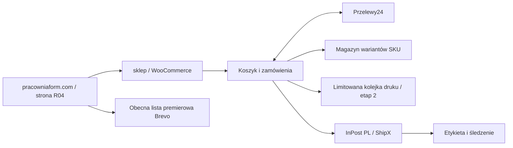

# Pracownia Form — propozycja architektury sklepu

Stan analizy: 1 listopada 2026. Dokument do zatwierdzenia; ten PR nie instaluje sklepu, nie zmienia DNS i nie aktywuje płatności. Ceny i warunki dostawców należy ponownie sprawdzić przy zakupie. Ceny, kolory, fotografie i parametry produktów pozostają nieustalone.

## Rekomendacja

**WordPress + WooCommerce na zwykłym hostingu PHP/MySQL, oficjalne moduły Przelewy24 i InPost PL.** Zachować wygląd R04 w lekkim własnym motywie, bez płatnego kreatora, headless, osobnego backendu i systemu pośredniczącego w zamówieniach. Panel WooCommerce wystarczy do pierwszych czterech modeli, klientów, zamówień, zwrotów i magazynu. To rekomendacja projektowa dla małej pracowni, pod warunkiem wskazania osoby odpowiedzialnej za aktualizacje i kopie.

Sam WooCommerce nie wymaga abonamentu ani udziału platformy w obrocie. Hosting, obsługa techniczna, płatności i przesyłki nadal kosztują. [Cennik producenta](https://woocommerce.com/pricing/).

| Wariant | Koszt stały / charakter | Ocena dla Pracowni Form |
| --- | --- | --- |
| WooCommerce | Bez licencji platformy; własny hosting i utrzymanie | Rekomendowany: kontrola SKU i produkcji, polskie integracje, mało niezbędnych usług |
| Shopify Basic | 79 zł/mies. przy płatności rocznej, czyli 948 zł/rok według obecnego cennika, plus płatności i ewentualne aplikacje | Mniej administracji serwerem; rozsądna alternatywa, jeśli nikt nie będzie utrzymywał WordPressa. InPost i produkcja wymagają osobnej oceny aplikacji |
| Obecny HTML + własny backend | Brak abonamentu silnika, ale duży koszt implementacji i utrzymania koszyka, zamówień, webhooków, zwrotów i panelu | Nie rekomenduję dla czterech modeli; niska cena infrastruktury nie oznacza taniego sklepu |

Cena Shopify pochodzi z [polskiego cennika](https://www.shopify.com/pl/pricing/); podatki i końcowe warunki należy sprawdzić przy zamówieniu. Nie zakładam bezpłatności jego dodatkowych integracji.

## Domena i zachowanie obecnej strony

Docelowo jeden hosting obsługuje `pracowniaform.com`: istniejące pliki HTML w katalogu głównym, a WordPress/WooCommerce początkowo w `/sklep/`. Chroni to obecne adresy `.html`, formularze Brevo i stronę WINTER 26 przed niepotrzebnym przepisywaniem. Motyw sklepu dziedziczy zatwierdzoną paletę, typografię i nawigację; logika zamówień znajduje się w silniku/wtyczce, nie w motywie.

Repozytorium zostaje źródłem wersjonowanego kodu. Obecny hosting GitHub Pages nie jest docelową platformą sklepu: GitHub ogranicza użycie Pages do prowadzenia działalności i e-commerce. Przed przyszłą publikacją komercyjną należy zatwierdzić zgodne miejsce hostowania. [Zasady GitHub Pages](https://docs.github.com/en/pages/getting-started-with-github-pages/github-pages-limits).

Migracja dopiero w osobnym wdrożeniu: kopia strony, konfiguracja SSL, próba na chronionym stagingu, test wszystkich dotychczasowych URL-i, zachowanie MX/SPF/DKIM poczty, kontrolowane przełączenie DNS i plan powrotu. Publiczne strony zachowują indeksowanie; `noindex` i autoryzacja dotyczą wyłącznie stagingu. Koszyk i checkout wyłączone z cache; statyczne grafiki mogą być cache'owane długo. Nie potrzebujemy odrębnego CDN na start.

## Koszyk, płatności i zamówienia

Standardowy koszyk WooCommerce i zakup bez konta. Klient wybiera zatwierdzony wariant, ilość i dostawę; przed zapłatą widzi pełną cenę oraz termin przygotowania. Podatki, walutę PLN i dokumenty sprzedażowe konfiguruje się według ustaleń z księgowością. Najpierw sprzedaż krajowa; rynki zagraniczne poza pierwszym etapem.

Oficjalny [moduł Przelewy24 dla WooCommerce](https://www.przelewy24.pl/do-pobrania/woocommerce) obsługuje integrację płatniczą. Dostawca udostępnia [bezpłatne wtyczki](https://www.przelewy24.pl/centrum-pomocy/wsparcie-techniczne-api/gdzie-znajde-wtyczki-do-platform-np-presta-shop-magento-woocommerce). Docelowo BLIK, szybki przelew i karty, po oddzielnym zatwierdzeniu konta, umowy i konfiguracji. Klucze wyłącznie na serwerze, nigdy w HTML/repozytorium. Potwierdzenie płatności pochodzi ze zweryfikowanej komunikacji operatora, a nie z samego powrotu klienta do sklepu.

Źródłem prawdy jest zamówienie WooCommerce. Zachowuje pozycje/SKU, cenę i podatek w chwili zakupu, metodę dostawy, punkt odbioru, obiecany termin, identyfikator płatności i historię zmian. Status płatności pozostaje oddzielony od etapu produkcji: oczekujące → opłacone → przygotowanie/produkcja → kontrola jakości → gotowe → wysłane. Anulowanie i zwrot mają własną ścieżkę; częściowy zwrot nie oznacza automatycznego przyjęcia uszkodzonego obiektu do magazynu.

Płatność i zmniejszenie stanu muszą następować tylko raz nawet po ponownym webhooku. Wykorzystać mechanizmy silnika i oficjalnej wtyczki, nie dopisywać drugiego odejmowania stanów. Nieopłacone rezerwacje wygasają. W Woo ustawienie czasu utrzymania stanu dotyczy oczekujących płatności, a nie wszystkich statusów — wymaga sprawdzenia z wybranym modułem płatności. [Ustawienia magazynu WooCommerce](https://woocommerce.com/document/configuring-woocommerce-settings/products/).

Powiadomienia transakcyjne przez istniejącą pocztę/SMTP po teście dostarczalności, niezależnie od zgody marketingowej. Lista premierowa Brevo zostaje; zakup nie dopisuje automatycznie do marketingu. Zachować klucz istniejącej zgody cookies i tę samą logikę opt-in także w motywie sklepu; jedna instalacja GA, bez zdublowanego pomiaru. Nowe zdarzenia zakupowe dopiero po osobnym wdrożeniu i testach.

## InPost

Oficjalna bezpłatna wtyczka **InPost PL**: wybór Paczkomatu w Geowidget, zapis identyfikatora punktu w zamówieniu, etykiety przez ShipX i śledzenie. Koszt wtyczki nie obejmuje przesyłek ani umowy przewozowej. [Instrukcja InPost](https://inpost.pl/aktualnosci-integracja-inpost-z-woocommerce-jak-skonfigurowac-dostawe-geowidget-i-koszty-wysylki-w).

Na start jedna czytelna tabela kosztów dostawy dla Polski, ustalona po pomiarze zapakowanych produktów i otrzymaniu oferty przewoźnika. Nie wymyślam stawki klienta. Etykieta tworzona po opłaceniu i spakowaniu; ponowienie żądania nie może tworzyć drugiej przesyłki. Przy niedostępnym punkcie lub błędzie ShipX zamówienie trafia do obsługi, bez utraty danych. InPost Pay i płatny agregator logistyczny nie są niezbędne do tego zakresu.

## SKU, magazyn i zestawy

Jeden model nadrzędny, warianty tylko dla faktycznie zatwierdzonych kombinacji koloru/materiału/rozmiaru. Każdy sprzedawany wariant ma unikalne SKU, cenę, fotografie, wagę i wymiary opakowania, dane bezpieczeństwa i dostępność. WooCommerce wspiera oddzielne parametry i stany wariantów. [Produkty wariantowe](https://woocommerce.com/document/variable-product/).

Przykładowy schemat, **nie nadane SKU**: `PF-W26-{MODEL}-{KOLOR}-{REWIZJA}`. Numer partii produkcyjnej to osobna informacja, powiązana z wydrukiem i kontrolą jakości, a nie nowy produkt przy każdym wydruku. Dostępny magazyn = gotowe, zaakceptowane sztuki minus rezerwacje. Materiał na szpuli oraz możliwość wydruku nie są stanem gotowego produktu.

Na start zestaw 2/4 może być zatwierdzoną ilością tego samego wariantu w koszyku; cena/rabat dopiero po decyzji właściciela. Gotowe, odrębnie skompletowane zestawy mogą mieć własne SKU i wydzielony stan. Mieszane zestawy korzystające ze wspólnych sztuk wymagają rozliczenia komponentów (BOM); nie wolno niezależnie wystawiać tego samego zapasu jako singli i zestawów. Konfigurator mieszanych kompletów odłożyć do potwierdzenia potrzeby.

## Druk na zamówienie bez nadmiernej automatyzacji

**Najprostszy start:** sprzedaż gotowych sztuk; przy braku stanu zapis zainteresowania drukiem, bez pobrania płatności. Pracownia ręcznie potwierdza wolny termin. Ten etap nie wymaga abonamentu ani systemu planowania produkcji.

Gdy potwierdzą się czasy wydruku i popyt, dodać płatne zamówienia produkcyjne w ograniczonych partiach. Sama opcja „backorders” nie jest planowaniem wydajności. Nie włączać nieograniczonej sprzedaży przy zerowym stanie.

Proponowane rozszerzenie to mała własna wtyczka z limitem partii tygodniowej, nie pełny system ERP. Osobno zapisuje: SKU, planowane minuty druku, bufor braków, obróbkę, kontrolę jakości, dostępną pojemność partii oraz przedział wysyłki. Rezerwacja pojemności jest atomowa i czasowa, powiązana z zamówieniem. Opłacenie utrwala ją dokładnie raz; wygaśnięcie/anulowanie oddaje slot. Spóźniona płatność po zwolnieniu slotu trafia do ręcznego uzgodnienia terminu lub zwrotu, nigdy do automatycznego przeciążenia produkcji. To **przyszła praca programistyczna**, a nie funkcja gwarantowana przez darmowy WooCommerce.

Koszyk mieszany gotowe + druk: domyślnie jedna wysyłka po ukończeniu całości, z terminem widocznym przed zapłatą. Rozdzielone wysyłki dopiero po ustaleniu dodatkowych kosztów. Niedostępny filament, awaria i wzrost kolejki muszą umożliwiać natychmiastowe zamknięcie przyjmowania nowych zamówień. Nie obiecujemy dat ani kolorów przed próbami produkcyjnymi. Zasady odstąpienia i personalizacji wymagają zatwierdzenia dokumentów z PR #4 przed checkoutem.

## Koszty i utrzymanie

Przykład budżetu, nie oferta zakupu: hosting LH Mango kosztuje obecnie **399 zł netto za odnowienie roczne** (33,25 zł netto/mies.; 490,77 zł brutto/rok przy VAT 23%). Uwzględnia SSL i dzienne kopie 30 dni. Używam ceny odnowienia, nie promocji pierwszorocznej. Przed wyborem sprawdzić limity CPU/RAM i kompatybilność Woo/wtyczek. [Cennik LH](https://www.lh.pl/hosting).

Przelewy24: **0 zł abonamentu**, standardowo **1,29% + 0,30 zł** za przelew online/BLIK/kartę 3DS; aktywacja 59 zł, zwracana po spełnieniu warunku 10 transakcji w pierwszych dwóch miesiącach. Wypłaty ponad bezpłatny limit mogą kosztować dodatkowo. Warunki umowy mają pierwszeństwo przed tym zestawieniem. [Tabela opłat P24](https://www.przelewy24.pl/oferta/tabela-prowizji-i-oplat).

Przykład wyłącznie rachunkowy: 100 transakcji po 120 zł = 12 000 zł obrotu; prowizja według powyższej stawki = **184,80 zł**. Kwota 120 zł nie jest propozycją ceny produktu. Osobno: domena, przesyłki, opakowania, ewentualna usługa SMTP, księgowość oraz praca przy utrzymaniu. Nie przedstawiam samego hostingu jako całkowitego kosztu sklepu.

Wycena jednorazowego wdrożenia musi obejmować motyw R04, checkout, integracje, migrację, testy i dokumentację; wtyczka ograniczania produkcji jako osobny etap. Nie ma podstaw do rzetelnej kwoty robocizny przed ustaleniem zestawów, liczby wariantów i procesu produkcji. Utrzymanie: wyznaczony opiekun, regularne aktualizacje najpierw na stagingu, monitoring błędów płatności/kolejek, backup poza kontem hostingowym i okresowy test odtworzenia. Brak opiekuna przemawia za Shopify mimo abonamentu.

## Kolejność decyzji i testy przed sprzedażą

1. Zatwierdzić tę architekturę, hosting i osobę utrzymującą; osobno zatwierdzić publikację strony zapowiedzi.
2. Po próbach uzupełnić rzeczywiste zdjęcia, ceny, warianty, SKU, wymiary, materiał, bezpieczeństwo, stany i wydajność produkcji; zdecydować o składzie zestawów.
3. Dokończyć dokumenty prawne, dane sprzedawcy/producenta, dostawę i obsługę zwrotów; zawrzeć umowy operatorów dopiero po decyzji właściciela.
4. Zbudować chroniony staging: zakupy gościa, dwie osoby kupujące ostatnią sztukę, wygasanie rezerwacji, płatność odrzucona/powtórzona/spóźniona, zwrot częściowy, brak Paczkomatu, awaria ShipX, brak zgody GA i poprawna wiadomość transakcyjna.
5. Dla druku dodatkowo: równoległa rezerwacja ostatniego slotu, anulowanie, awaria drukarki, wyczerpanie partii i koszyk mieszany. Porównać stan przed/po; odtworzyć kopię.
6. Dopiero po odbiorze odrębna zgoda na migrację, produkcyjne klucze i uruchomienie sprzedaży. Niniejszy PR niczego z tej listy nie aktywuje.
