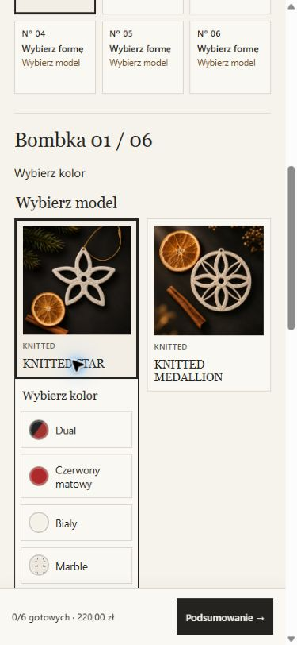
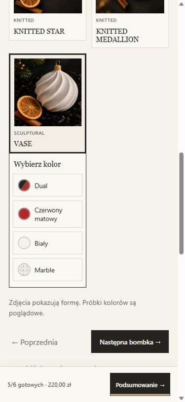

# WINTER 26 — mobile configuration journey

Owner phone acceptance found a six-item set with six models but only five colors:
the first VASE had no color and the disabled checkout gave no useful next action.

The new UI has three steps: size (1/2/4/6/8), composition and summary. Each numbered
ornament has a model/color/completion status. A single active item has previous/next
navigation. The selected model card contains its own color palette, with labelled,
illustrative color chips. Approved product photography and SKU photo assignments
are untouched; the chips do not claim to be exact physical samples.

The summary displays each ornament separately with an edit action, delivery and
total. Every incomplete item has its own link. The final action stays usable:
incomplete selection navigates directly to the missing model/color instead of
issuing checkout. Only a complete, available selection, destination and applicable
Live consent can send a checkout request. The busy guard prevents concurrent
requests; retry still uses the existing idempotency behavior.

A sticky mobile summary displays completion and price. The inactive coupon field
is hidden. Customer-facing MOCK selection contains only TEST01M and TEST02M, with
a discreet test-delivery notice. Backend failure fixtures remain available for
automated testing but are not listed to customers.

## Validation

- Actual controller regression for 1/2/4/6/8: missing model/color, exact missing-item
  navigation, editing, model change clears color, repeated variants, unavailable
  color, immediate progress, and one in-flight checkout request.
- Existing composition suite: mixed packs, availability across packs, removal,
  courier/locker prices, legal/Live gates, destination and retry behavior.
- Existing MOCK UI suite: both synthetic points, canonical address, invalid/error
  responses, courier switch and Live rejection.
- Fresh clean build: PHP lint, all three checkout suites, pricing/catalog/render,
  publication, consent, configuration and MOCK UI checks passed.
- Real browser reproduction: six models/five colors identifies first VASE, jumps
  to its palette, then immediately shows 6/6 after choosing its color.
- 320/360/390/430 px: no horizontal overflow, color targets at least 48 px high,
  palette verified inside the selected card. These are browser viewport tests;
  owner physical-phone acceptance remains required.
- No additional Sandbox payments or checkout requests were made against Uberspace
  while preparing this UX update.

## Release and deployment boundary

Build source: `ab1a5f577b93d5ab58a20d40e4e8f00db8c51a08`.
Final staging archive: 124 files, SHA-256
`daaa9390f7795be8d80d169934f80eb03d34a770af55b8b727d985c458db8b39`.
Only three public files differ from the accepted staging release:
`winter-config.js`, `winter-atelier.css`, `winter-zestaw-4.html`.
Backend, prices, SKU, commercial inventory, photos, legal pages, security overlays
and private configuration are unchanged.

**Deployed and verified on pf26.uber.space, 14 November 2026.** The scoped deployer
verified the existing release, backed up the three previous files outside
DocumentRoot, replaced only those files, and verified all 124 final hashes.
Anonymous access remains 401 with noindex/noarchive and no-store; authenticated
responses serve the exact new bytes. Private configuration is unchanged.
Read-only SQLite snapshots before/after are identical: two paid orders, one
released reservation, the same inventory and event ledger. No seed or payment
was run. The verified rollback is recorded in [deployment evidence](ux-20261114/deployment.json).

Actual HTTPS browser acceptance repeated the six-model/five-color VASE case:
the final action selected the first ornament and focused its color palette;
choosing white immediately showed 6/6. Individual item editing, courier and both
TEST01M/TEST02M selections passed. Only those two points are listed, and the coupon
field is hidden. Remote viewport measurements at 320/360/390/430 show no horizontal
overflow and color controls at least 48 px high. No new checkout or payment was
submitted during browser acceptance. Physical-phone comfort is for owner review.

PR #28 remains draft, with no merge or production release.

[Viewport measurements](ux-20261114/mobile.json) ·
[Staging build identity](ux-20261114/release.json)

[Remote viewport measurements](ux-20261114/remote-mobile.json)

