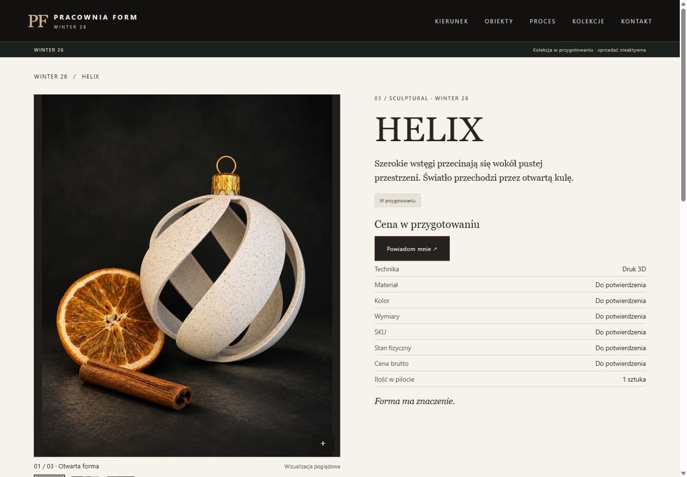
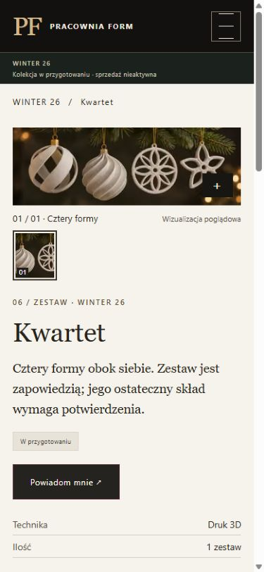

# WINTER 26 — odbiór sklepu, 04.11.2026

**GO do przeglądu lokalnego. NO-GO dla sprzedaży i wdrożenia.** Nowa gałąź od `6d8e07b` (PR #11). Katalog, strony szczegółowe i zdjęcia działają na statycznych plikach dla LH Orange. Bez backendu, kont Stripe, płatności i rezerwacji magazynowych. Główne zdjęcie, jego opis, pliki i układ hero pozostały takie jak w PR #11.

Lokalnie: `python -m http.server 8772 --bind 127.0.0.1`; otwórz [WINTER 26](http://127.0.0.1:8772/winter-26.html). Kliknięcie obrazu, nazwy lub „Poznaj obiekt” otwiera kartę. Miniatury przełączają ujęcia, Enter powiększa, Escape zamyka i przywraca fokus. Bez JS treść i obrazy są w HTML, odnośnik otwiera duży WebP. Bez zdjęcia widać tekstowy zastępnik, bez danych zakupowych — „Powiadom mnie o przedsprzedaży” do listy informacyjnej.

| Model / osobna karta | Materiał (klucze ujęć w kolejności galerii) | SKU / link |
|---|---|---|
| [KNITTED STAR](../winter-knitted-star.html) | star, star-loop — sznurek w otworze, bez kapturka | null / null |
| [KNITTED MEDALLION](../winter-knitted-medallion.html) | medallion-detail — nieprzewleczony otwór; medallion-loop — przewleczony złoty sznurek, bez kapturka | null / null |
| [HELIX](../winter-helix.html) | helix, helix-detail — otwarte wstęgi, złoty kapturek i oczko | null / null |
| [FULL SOFT](../winter-full-soft.html) | full-soft, full-soft-side — pełna spiralna kula, złoty kapturek i oczko | null / null |
| [Duet](../winter-zestaw-2.html) | Brak potwierdzonej kompozycji i materiału przedstawiającego duet | null / null |
| [Kwartet](../winter-zestaw-4.html) | four — studyjne zestawienie modeli; bez ujęcia opakowania | null / null |

**Materiały:** obejrzano dziewięć PNG w folderze właściciela. Użyto czterech samodzielnych ilustracji (-2 do -5) i wybranych kadrów planszy 294daed2…: łącznie dziewięć ujęć. Nie użyto sceny -1 (fikcyjne metalowe kapturki na płaskich ozdobach) ani dwóch pozostałych plansz. Wykonano wyłącznie kadrowanie planszy, skalowanie proporcjonalne i kodowanie; bez generowania, retuszu czy rekonstrukcji sznurków. Wszystkie materiały opisano jako kadry koncepcyjne, nie dokumentację gotowego wariantu. Odrzucone pudełko (-6) usunięto z galerii, manifestu, importera i plików wydania. Nowe ujęcie opakowania dopiero po sesji fizycznego wzoru. Oryginały zachowane poza repozytorium, w podanym folderze. Repo zawiera tylko zoptymalizowane obrazy oraz nazwy i hashe wykorzystanych źródeł.

**Odbiór zdjęć po sesji:** główne zdjęcie sprzedażowe KNITTED MEDALLION musi pokazać realny złoty sznurek przełożony przez otwór, bez metalowego kapturka. Do tego czasu pozostaje dotychczasowy detal. Wycinek medallion-loop (264 px) jest wyłącznie ujęciem pomocniczym; nie promować go do zdjęcia głównego. Przy zmianie zdjęć produktów nadal sprawdzać zamrożony hero PR #11; jego wzorzec testowy aktualizować wyłącznie po odrębnej akceptacji konkretnej zmiany hero przez właściciela.

**Edycja:** [rejestr](../data/winter26-products.json) zawiera parametry produktu, źródła/alt, typ zdjęcia, status i dane zakupowe; [mapa obrazów](../data/store-media.json) zawiera wymiary, szerokości eksportów, kadry i SHA-256 oryginałów. Aby wymienić ujęcie: zapisać nowe AVIF/WebP w `assets/store/<klucz>-<szerokość>.<format>`, uzupełnić mapę i rekord zdjęcia, ustawić zgodny z pochodzeniem opis, wykonać `python scripts/render_store.py`. Można też użyć [importera](../scripts/import_store_images.py) (Pillow z AVIF, katalog źródeł jako argument); dla nowych nazw/kadrów zmienić listę ujęć importera. Nie edytować ręcznie wygenerowanych kart. `--check` sprawdza zgodność HTML/sitemap z rejestrem. Wszystkie dotychczasowe URL-e i kotwice zachowane.

**Stripe:** [warunki CTA](../scripts/store_gate.py) są sprawdzane podczas budowy. Każdy gotowy fizyczny wariant/zestaw wymaga unikalnych SKU i linku, rzeczywistych fotografii, danych GPSR, kwoty brutto, stanu większego od zera i terminu nadania. Zestaw wymaga własnego składu i odseparowanego zapasu. Po osobnym odbiorze operator porównuje na stronie Stripe SKU, aktualną cenę PLN, ustaloną metodę dostawy, adres, telefon, koszt dostawy i ilość zablokowaną na 1. To ręczne potwierdzenie właściciela, nie zapytanie do API Stripe: generator nie sprawdza zdalnie istnienia, aktywności ani aktualnych parametrów linku. Zapisuje się sprawdzony zestaw parametrów w `verifiedCheckout` (url, sku, pricePLN, shippingPLN, quantity, adjustableQuantity, currency, country). Inna cena, link, kraj lub dostawa unieważnia zgodność. Globalne zgody i sandbox pozostają false; wszystkie linki są null. Samo wklejenie URL nigdy nie wystarcza. Dane testowe są wyłącznie izolowanym przypadkiem w teście, nie trafiają do HTML.

Ewentualna sprzedaż: osobno zatwierdzić konfigurację rzeczywistego checkoutu Stripe. Po opłaceniu sprawdzić status płatności w Dashboard, zgodność SKU/kwoty i brak wcześniejszej realizacji; sam redirect nie dowodzi zapłaty. Metoda InPost, koszt i ręczny proces nadania wymagają osobnego zatwierdzenia. Nie ma jeszcze decyzji o Kurierze, Paczkomatach, wspólnym koszyku, dowolnych kombinacjach ani automatycznym odjęciu stanu. Po wyczerpaniu zapasu najpierw dezaktywować checkout u operatora, uzgodnić otwarte sesje, potem zmienić rejestr i odbudować stronę. Limit sesji nie jest atomową rezerwacją. Przy nadmiarowej płatności wstrzymać realizację, uzgodnić dostępność lub zwrot. Szczegóły operacyjne: [pilot PR #10](https://github.com/pracowniarachunkowosci-debug/form/blob/codex/issue-9-lean-pilot/docs/STRIPE_LEAN_PILOT.md).

**Blokery przed zakupem — wszystkie otwarte:**

- Dla każdego oferowanego SKU: rzeczywisty wariant/kolor, materiał, wymiary, fotografie, identyfikacja/partia, cena brutto PLN, potwierdzony gotowy stan; dla zestawów dodatkowo dokładny skład, sposób pakowania i odrębny zapas.
- Koszt dostawy, termin nadania, procedura utrzymywania dostępności przy równoległych płatnościach, obsługa zwrotów i reklamacji.
- Odbiór danych sprzedawcy i kontaktu, producent i dane kontaktowe, ocena ryzyka, identyfikator i instrukcje/ostrzeżenia GPSR; dane spółki z PR #11 zachowane. Siedziba nie jest automatycznie adresem zwrotów.
- Formalnie zatwierdzone regulamin, prywatność, odstąpienie/zwroty, reklamacje, daty i obowiązki księgowe. Sprawdzono wcześniejszą [listę blokad PR #4](https://github.com/pracowniarachunkowosci-debug/form/blob/codex/issue-3-winter26-draft/docs/BLOCKERS_BEFORE_LAUNCH.md) i [bramki PR #11](RELEASE_READINESS.md); dokumenty są projektami.
- Rzeczywiste mapowanie SKU → Stripe Product/Price/Payment Link i osobno dozwolony test sandbox: sukces, odmowa, anulowanie, opóźniony wynik, dwie sesje, limit, dostawa, zwrot. Brak testów konta Stripe i rzeczywistej wysyłki Brevo. Osobna zgoda na uruchomienie i wdrożenie LH/DNS.

**Testy:** `python scripts/check_publication.py` PASS: 16 stron, 596 odwołań, zachowane kotwice, formularz, SEO/sitemap oraz identyczna część hero jak w PR #11. `node scripts/check_consent.cjs`, `node --check store-gallery.js`, `python scripts/render_store.py --check` i `python scripts/check_store_gate.py` PASS. Test bramki sprawdza m.in. brak zapasu, dokumentów, GPSR, niezatwierdzony zestaw, duplikat linku, niezgodną cenę/dostawę i błędny host. Brak połączeń do Stripe.

Przed recenzją sprawdzono w Chrome: katalog i sześć stron szczegółowych × 1440/390/320 px — 21 widoków bez poziomego overflow. Sprawdzono przejście z karty katalogu, przełączanie miniatur strzałką, otwarcie powiększenia przez Enter, Escape i powrót fokusu. Obrazy AVIF załadowane na desktop/mobile; niezależne od zgód. Po odmowie brak załadowanego skryptu GA. Kontrast tekstu głównego na karcie 13,8:1, CTA 15,0:1; to nie jest pełny audyt WCAG.

Po [recenzji PR #13](https://github.com/pracowniarachunkowosci-debug/form/pull/13#issuecomment-6635610672) sprawdzono ponownie HELIX (1440 px) i Kwartet (390 px): brak poziomego przewijania, pustych specyfikacji i linków płatniczych. Lokalny ZIP oraz jego manifest nie zawierają odrzuconego pudełka. Oddzielny test generuje gotowe SKU poza podglądem: koszt dostawy, nadanie i zwroty poprzedzają górny „Kup”, dolny przycisk prowadzi pod ten sam adres, a zerowy stan wyłącza oba.

| Desktop | Mobile |
|---|---|
|  |  |

[Katalog — para KNITTED](previews/store-desktop.jpg). Wszystkie podglądy pochodzą z działającej strony.
