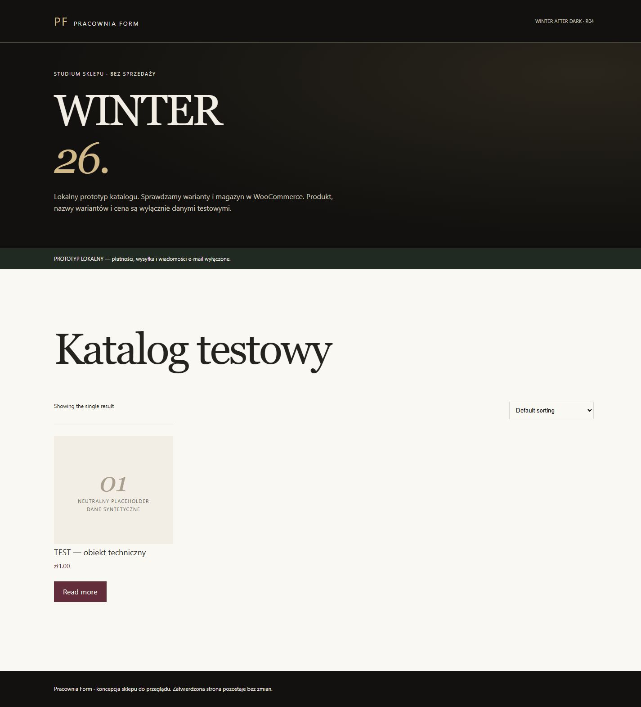
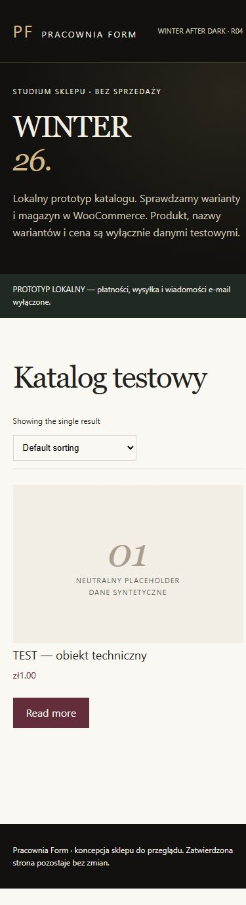
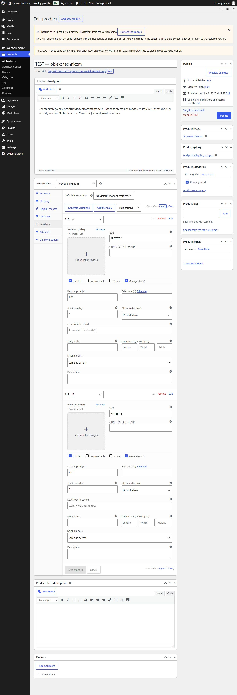
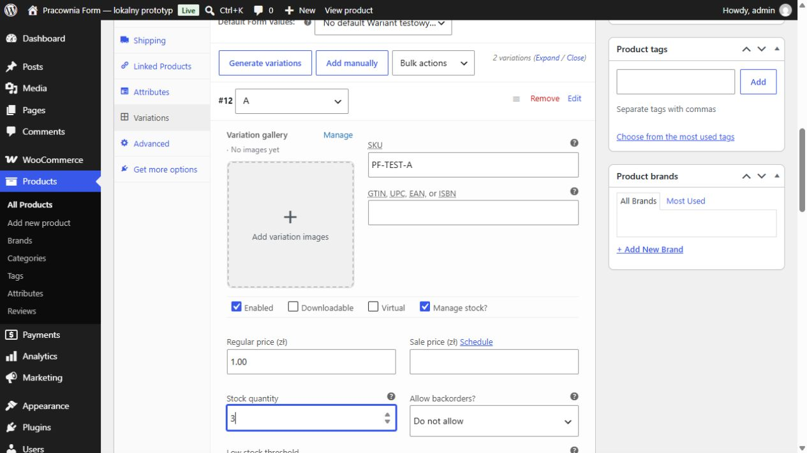

# Prototyp WooCommerce po recenzji PR #7

02.11.2026 · lokalny eksperyment do przeglądu, bez zgody na wdrożenie.

[Recenzja](https://github.com/pracowniarachunkowosci-debug/form/pull/7#pullrequestreview-5738562410) rekomenduje sprawdzenie administracji Woo przed decyzją o hostingu. Prototyp jest na osobnej gałęzi `codex/woo-local-prototype`, od `main` `38e0bd9`. Nie zmienia stron statycznych, formularzy, SEO, cookies, analityki ani PR #5. Wszystkie pliki aplikacji demonstracyjnej znajdują się w `prototypes/woo/`.

## Wynik i sposób użycia

[Instrukcja uruchomienia](../prototypes/woo/README.md) opisuje Node i oficjalny WordPress Playground. Sprawdzony zestaw: Node 24.18.0, Playground 3.1.62, WordPress 7.1.4, WooCommerce 11.2.1, PHP 8.3.36, SQLite. W tym komputerze nie było działającego lokalnego PHP/MySQL ani uruchomionego silnika Docker; nie instalowano nowej usługi systemowej. Użyto przenośnego Node w ignorowanym katalogu lokalnym, bez zmiany systemowej wersji.

Motyw jest małym studium integracji katalogu z paletą R04: midnight, forest, champagne, paper i burgundy. Zatwierdzona strona z PR #5 pozostaje wzorcem przyszłego wdrożenia. To nie pełne przeniesienie wszystkich sekcji, typografii i zasobów produkcyjnej strony. Neutralny placeholder nie przedstawia fikcyjnego modelu kolekcji.

Jeden produkt techniczny ma dwa warianty: A (`PF-TEST-A`, 3 sztuki) i B (`PF-TEST-B`, 0 sztuk), brak backorderów oraz cenę testową 1 PLN. Są to dane syntetyczne, nie propozycja ceny ani SKU kolekcji. Druku na zamówienie, prawdziwych zamówień i rezerwacji produkcji jeszcze nie wdrożono.

## Weryfikacja

| Sprawdzenie | Wynik / granica wniosku |
| --- | --- |
| Produkt variable, dwa warianty, stany 3/0 | PASS przez API PHP Woo |
| Zapis stanu A 3 → 2, nowy odczyt, przywrócenie 3 | PASS przez API PHP Woo |
| Panel Woo: edycja A 3 → 2, Save changes, przeładowanie i odczyt | PASS: `PF-TEST-A` = 2, `PF-TEST-B` = 0; dowód poniżej |
| Panel Woo: przywrócenie A do 3, zapis, przeładowanie i odczyt | PASS: A = 3, B = 0 |
| Blokady zakupów, bramek, poczty i WordPress HTTP API | PASS; zero utworzonych zamówień |
| HTTP katalogu, motyw R04, lokalny noindex | PASS: HTTP 200, treść i nagłówek |
| POST Store API checkout | PASS: HTTP 403 |
| Nasłuch | PASS: wyłącznie `127.0.0.1`, bez tunelu |
| Ręcznie uruchomiony runner Action Scheduler | PASS: `executed: true`, `status: complete`, zapis efektu callbacka |
| Desktop 1440 × 900 / mobile 390 × 844 | Zapisane podglądy pełnej strony; czytelny placeholder i komunikat testowy |
| MySQL/HPOS, produkcyjny cron, restore, obciążenie i równoległe rezerwacje | Niewykonane; osobny etap odbioru |
| P24/InPost sandbox | Niewykonane; [osobny plan](WOO_SANDBOX_PLAN.md) |

Próba Action Scheduler jest odrębna od testu stanów: odczytujemy **zarówno status zadania, jak i zapisany efekt callbacka**. Sam `complete` nie wystarcza. Pierwsza wersja próby rejestrowała callback tylko w pojedynczym wywołaniu PHP; poprawiono rejestrację do mu-pluginu ładowanego w każdym procesie. Wynik ręcznie uruchomionego runnera, nawet pozytywny, nie dowodzi cyklicznego działania hostingu bez ruchu. `DISABLE_WP_CRON` pozostaje lokalnie włączone.

[Wynik testu PHP/HTTP](woo-local-verification.json) zawiera wyłącznie syntetyczne ID i wersje, bez sesji lub sekretów. Panel sprawdzono osobno w przeglądarce. Pojedynczy worker zatrzymywał ładowanie formularza; po przejściu na sześć workerów panel załadował oba warianty i zapisał zmianę. Jeden start sześciu workerów zakończył się błędem aktywacji Woo, ponowny czysty start przeszedł. To ograniczenie stabilności lokalnego Playground do dalszej obserwacji, nie dowód awarii ani niezawodności hostingu Woo. Panel pozostaje anglojęzyczny w tej paczce testowej; wdrożenie wymaga polskiej lokalizacji i jednostek kg/cm przed integracją dostawy.

## Podglądy

## Następny odbiór

Wybór hostingu wymaga decyzji właściciela oraz odpowiedzi na luki opisane w [shortliście PR #7](https://github.com/pracowniarachunkowosci-debug/form/blob/codex/issue-6-store-tco/docs/WOO_HOSTING_SHORTLIST.md). Następnie: prawdziwy MySQL, backup/restore, cron co 1–5 min i test bez wejść klientów, dopiero później zatwierdzony sandbox P24/InPost. Lokalne blokady, auto-login i SQLite nie są konfiguracją do publikacji. Nie kupiono usług, nie zmieniono DNS, nie wykonano merge ani wdrożenia.
