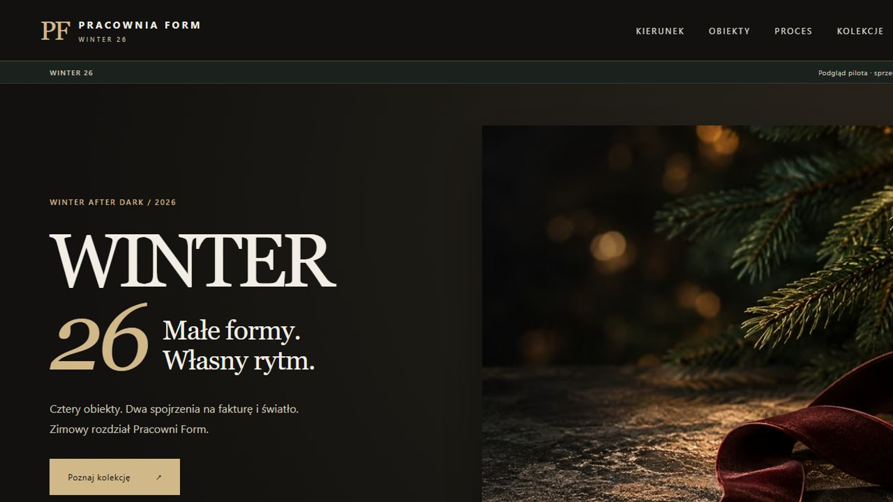
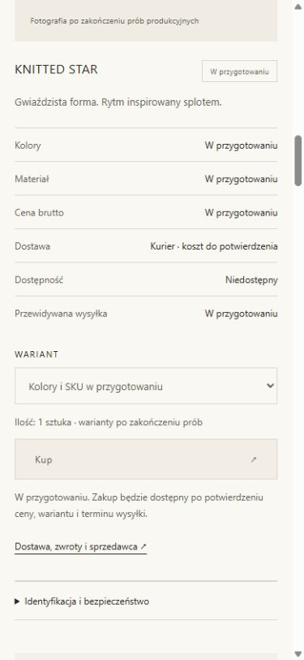

# Lokalny projekt pilota — bez sprzedaży

Uruchom w katalogu repo: `python -m http.server 8766 --bind 127.0.0.1`.
Otwórz `http://127.0.0.1:8766/previews/lean-pilot/winter-26.html`.

R04 (HTML jako punkt wyjścia, CSS i zoptymalizowane AVIF/WebP bez zmian) pochodzi z PR #5, commit `f97fcd65f2625dcc4f18aabf65c3a8e467a5a947`. Wspólne style i skrypt są odczytywane z root repo. Dodatki dotyczą wyłącznie pilota: cztery wyłączone przyciski Kup, niezatwierdzone warianty, kurier, informacje przed zakupem. Hero pozostaje neutralnym editorialem bez produktu.

To oddzielny materiał do przeglądu, **nie pliki do wdrożenia**. `noindex`, brak ID analityki i CSP blokujący połączenia/formularze są celowe tylko tutaj. Brak formularza zamówienia, sekretów i linków Stripe. Nie kopiować tych ustawień do produkcji. Link do listy premierowej prowadzi do istniejącej strony — nie używano go do zapisu danych testowych.

Root `index.html`, `script.js`, dokumenty i pozostałe pliki produkcyjne są niezmienione; ich uzupełnienie/migracja wymaga osobnej pracy po zatwierdzeniu. Zachować działające Brevo, double opt-in, zgodę na analitykę i canonical przy przyszłym wdrożeniu.

## Sprawdzenie 03.11.2026

Odczyt DOM przy 1440 i 390 px: brak poziomego overflow, cztery wyłączone CTA, cztery karty i poprawnie załadowany hero. Brak błędów/ostrzeżeń konsoli. Sprawdzono zgodność CSS/obrazów z R04, poprawność lokalnych odnośników, brak formularza/linków płatniczych oraz niezmienność plików produkcji. Obliczenia prowizji i wydatków 3/6 miesięcy sprawdzono niezależnie z Decimal.

Sandbox Stripe, wysyłki, migracja DNS i prawdziwy zapis Brevo **nie były uruchamiane**. Nie jest to odbiór sprzedaży produkcyjnej.

[Pełny desktop](../../docs/previews/lean-desktop-full.jpg)

